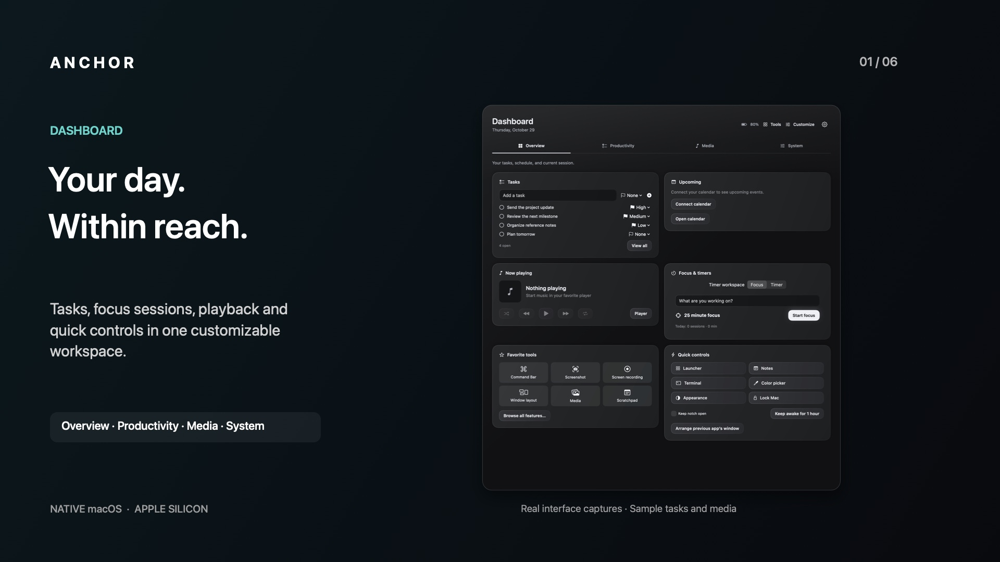
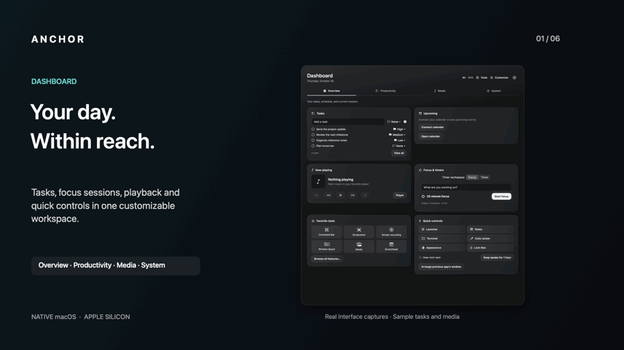
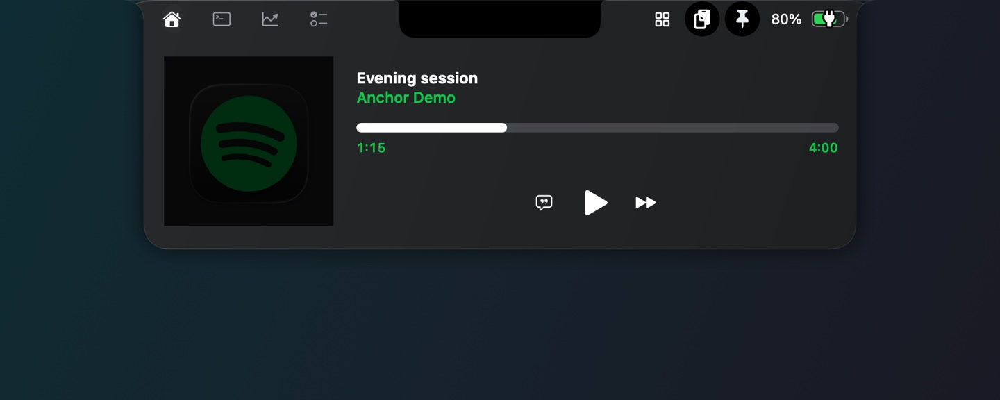
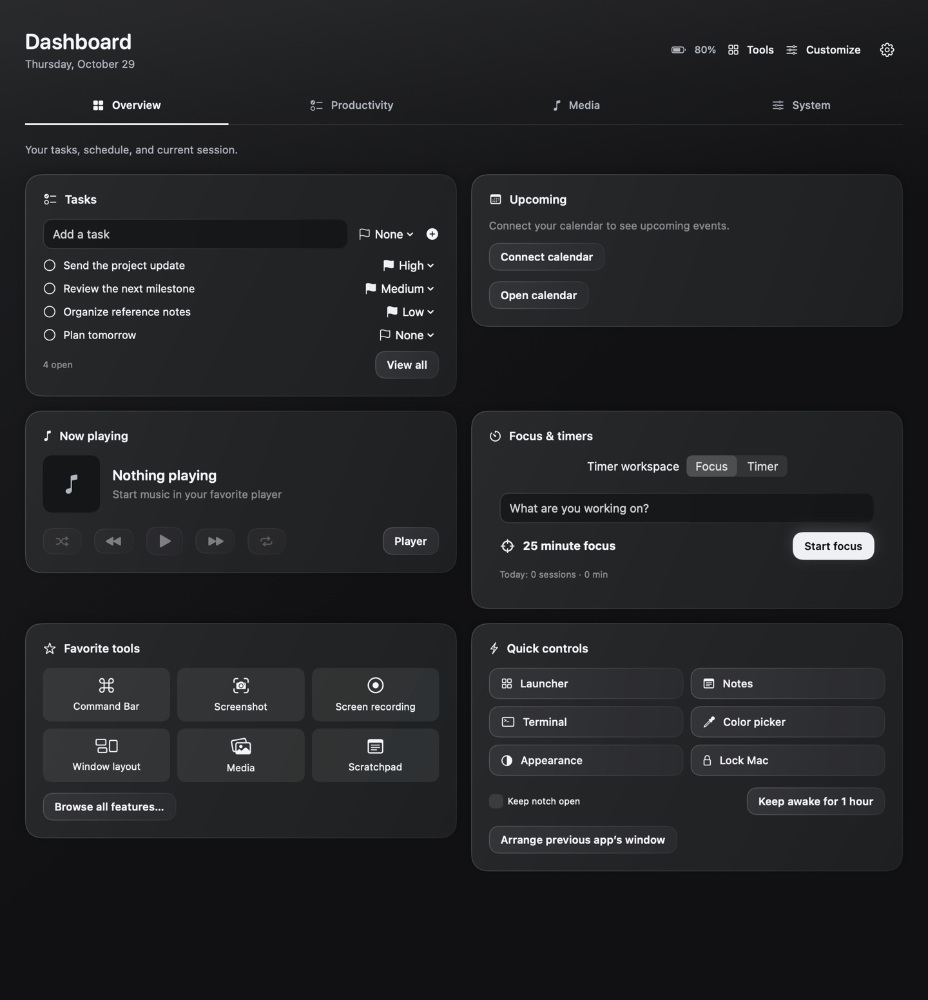
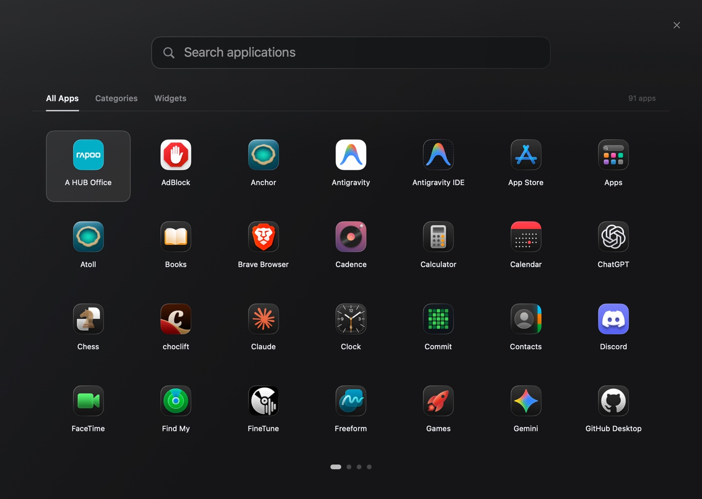
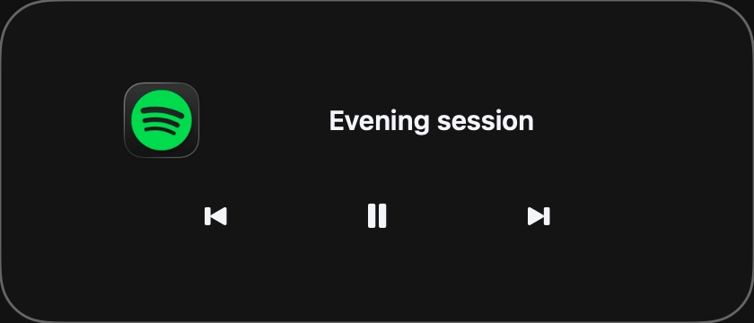
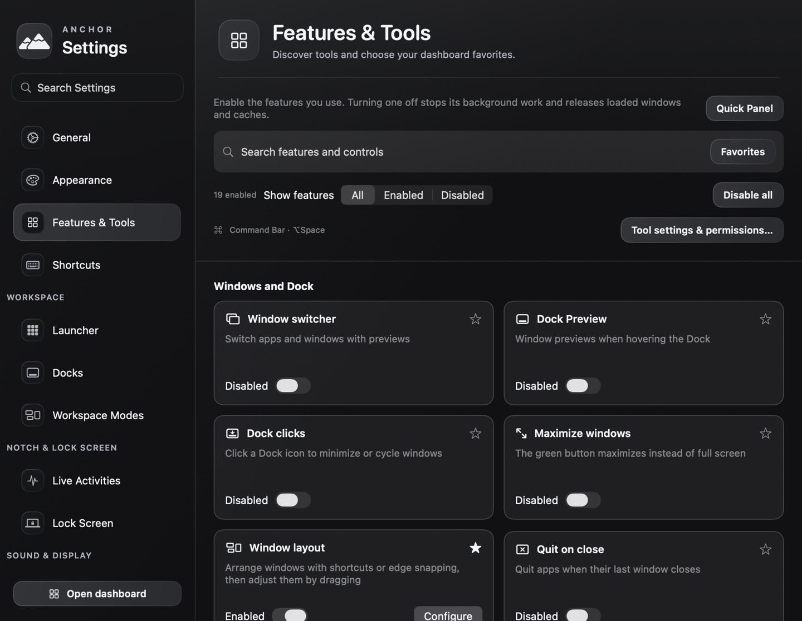
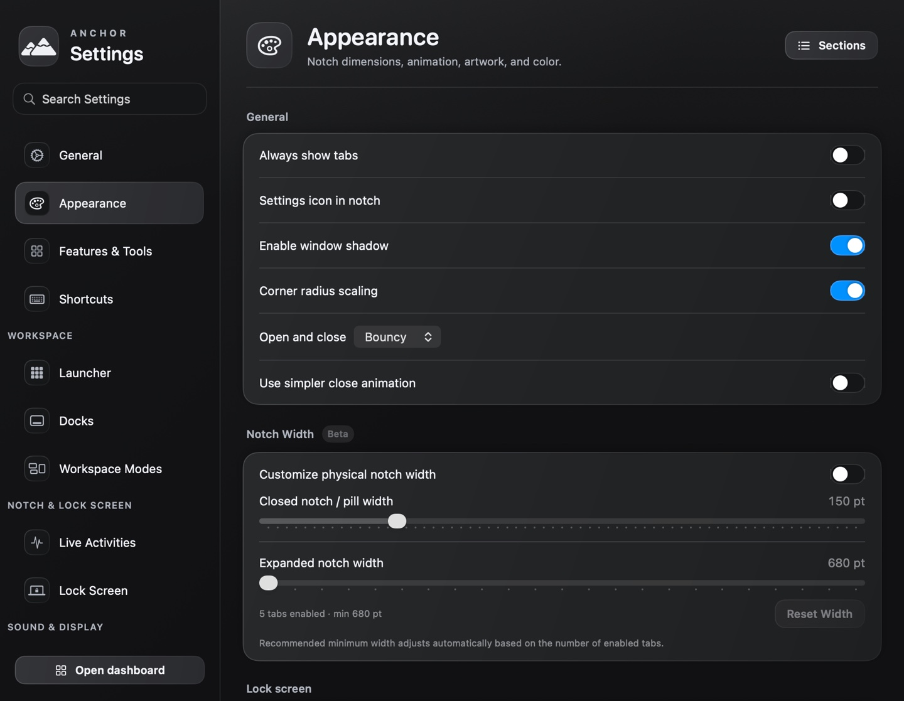

<div align="center">

# Anchor

**Your Mac’s notch, workspace, and everyday tools in one native app.**

[](#requirements)
[](#requirements)
[](#development)
[](LICENSE)

[Watch the tour](#see-anchor-in-action) · [Feature tour](#feature-tour) · [Getting started](#getting-started) · [Build from source](#build-from-source) · [Privacy](#permissions-and-privacy) · [Development](#development)

</div>

[](#see-anchor-in-action)

Anchor brings playback, tasks, timers, files, and system controls to the top edge of your screen. Expand the notch for a quick action, open Dashboard for a wider workspace, or use the launcher to find an app, command, Shortcut, or quicklink.

It is a native SwiftUI and AppKit application for Apple Silicon. Optional tools cover audio, window management, recording, dictation, clipboard workflows, and system maintenance. Choose the tools you need in **Features & Tools**; configure their behavior in searchable Settings.

## See Anchor in action

**36-second interface tour · 1080p**

https://github.com/user-attachments/assets/05d5f209-45a3-4e10-8875-d3d8fc9cd695

A silent, captioned interface tour assembled from real native UI captures, with sample tasks and media. Expand the preview below for a short animation; the rest of this page uses still images.

<details>
<summary>Play the animated preview</summary>



</details>

| Time | In the tour |
| --- | --- |
| 0:00 | Dashboard: tasks, focus, playback, and quick controls. |
| 0:06 | Expanded notch: media and actions at the top edge. |
| 0:12 | Launcher: search or browse installed applications. |
| 0:18 | Features & Tools: choose utilities and favorites. |
| 0:24 | Settings: find and customize individual controls. |
| 0:30 | Media: a compact lock-screen player. |

## Feature tour

### A notch that works across your displays

- Expand the notch on hover, by clicking, or with a configurable shortcut. Pin it open when you want controls to stay available.
- Use a top-edge pill on displays without a physical notch. Choose whether Anchor appears on one display or several, and customize size, material, and animation.
- Switch between media, notes, tasks, calendar, files, terminal, and system statistics.
- See contextual activities for timers, downloads, battery changes, dictation, privacy indicators, and supported system events.
- Add optional lock-screen media, weather, calendar, reminders, and timer surfaces. Their appearance and content settings live together in **Settings → Lock Screen**.



### Dashboard: an overview you can customize

Dashboard has four tabs: **Overview**, **Productivity**, **Media**, and **System**. Each tab has its own choice of cards and layout.

| Card or workspace | What it brings together |
| --- | --- |
| Tasks | Add and complete tasks, set priorities, and open the full list. |
| Upcoming | See upcoming calendar events from the next seven days. |
| Now playing | View the current track and use playback controls. |
| Focus & timers | Start a focus session or countdown without leaving the dashboard. |
| Files & clipboard | Stage files and return to saved clipboard items. |
| Sound & display | Adjust available volume and brightness controls. |
| System health | View CPU, GPU, memory, temperature, battery, and network readings where supported. |
| Favorite tools | Star actions in Features & Tools to keep them close at hand. |

Open it from Anchor’s menu, the notch’s dashboard button, or launcher search. Use **Customize** to choose cards for the current tab. Existing customized layouts stay yours.

<details>
<summary>View the full Dashboard screenshot</summary>



</details>

### Launch apps and move between workspaces

Search installed applications, built-in commands, Apple Shortcuts, and saved quicklinks in one interface. App matching supports prefixes, acronyms, accents, reordered words, and small typing mistakes. Exact and prefix matches take priority over usage history.

The launcher also offers an application grid, categories, folders, sorting options, and optional widgets. A ring switcher provides forward and reverse application switching. Replacing macOS’s **Command-Space** or **Command-Tab** behavior is optional.

Create movable desktop docks with their own apps, orientation, and size. Workspace Modes save combinations of app/window layouts, dock visibility, volume, and brightness. Display- and power-based rules are opt-in; configure them in **Settings → Workspace Modes**.



### Media and per-app sound

- Control supported players, including Apple Music, Spotify, and YouTube Music integrations, with artwork, progress, lyrics, and playback controls. Available actions depend on the player and integration.
- Use a floating player, desktop vinyl, or lock-screen player. Customize supported player layouts and visualizers.
- Control application volume and mute, route supported audio, and apply a 10-band equalizer, imported AutoEQ profiles, and loudness processing.
- Choose audio devices, pin a microphone, or assign shortcuts for output switching and microphone mute.
- Customize volume and brightness HUDs using notch, pill, circular, or vertical presentations. External-monitor controls depend on the display and connection; Lunar integration is available for supported setups.



### Capture, write, and organize

| Tool | Capabilities |
| --- | --- |
| Dictation | Hold the push-to-talk shortcut, speak, then release to transcribe using Apple’s on-device SpeechAnalyzer/SpeechTranscriber. Paste into the focused app or keep the transcript on the clipboard. Language/model availability depends on macOS and installed assets. |
| Screenshots & recordings | Capture the screen, then use native editing, annotation, and export tools. Recording options depend on the selected capture source and permissions. |
| Media tools | Process images, video, audio, and documents through the available utility actions. |
| Clipboard | Search history, retain useful entries, paste plain text, and configure source exclusions, retention, and privacy controls. |
| File shelf | Stage files between apps and spaces, preview items, and use file actions. |
| Notes & tasks | Keep quick notes and prioritized tasks nearby; connect supported Apple Notes and Reminders workflows when needed. |
| Text & links | Expand snippets, open quicklinks, and clean tracking parameters from copied URLs. |
| Focus | Run focus sessions, countdowns, and optional eye-break reminders. |

### System tools when you need them

Features & Tools includes window layouts and snapping, Dock behavior, input utilities, color picking, camera previews, menu-bar organization, battery information, process/system monitoring, cleanup, and app-management actions.

**Native window tiling and Spaces:** General and Window Layout settings share the macOS Desktop & Dock switches for edge tiling, menu-bar filling, and Option-drag tiling. Spaces ordering reads and changes the Dock’s own state, notifying System Settings without restarting the Dock. These interfaces are undocumented; unsupported or managed values disable editing, and failed writes show an error. Changes made elsewhere refresh without polling. Custom keyboard placements remain separate, and Anchor’s advanced custom edge zones defer to macOS while native tiling is enabled. Per-device pointer acceleration still uses its existing override and recovery implementation; it is not claimed as a synchronized native control.

Optional developer tools include local Claude Code usage monitoring, reset alerts, and scheduled Git workflows. The AI assistant supports configured providers and uses your own credentials. These integrations have their own settings and network behavior; they are not prerequisites for the notch or dashboard.



## Requirements

| Component | Requirement |
| --- | --- |
| macOS | **26.0 or later** |
| Processor | **Apple Silicon / arm64** |
| Display | A notched MacBook or a display using Anchor’s top-edge pill |
| Development | Xcode 26 or later with the macOS SDK; validated with Xcode 26.6 |

Intel and older macOS versions are not current build targets. Hardware readings, display control, audio routing, and third-party integrations vary with the connected devices and available APIs.

## Getting started

This repository currently provides source code, with no packaged GitHub release. Follow [Build from source](#build-from-source) to create a local app.

1. Launch Anchor and complete onboarding. Enable the features you intend to use.
2. Open **Settings** from Anchor’s menu or press **Command-Comma** while Anchor is active. Search by a feature name or setting label; use the pane’s **Sections** menu to jump within it.
3. Open **Features & Tools** to browse optional utilities. Star your favorites, then choose their Dashboard cards with **Customize**.
4. Review **Shortcuts**, especially if you already use another launcher, window manager, clipboard manager, or audio utility. Choose one owner for overlapping shortcuts and background replacements.
5. Connect calendars, media services, or other integrations as needed. Permission prompts belong to the features that require them.

<details>
<summary>View the Settings window</summary>



</details>

### Native shortcut defaults

These are Anchor’s native defaults. Saved bindings and the enabled utility owner can change which action handles a shortcut; the optional Command Bar also has its own binding.

| Shortcut | Action |
| --- | --- |
| **Option-Space** | Native launcher |
| **Option-Tab / Option-Shift-Tab** | Ring switcher, forward / reverse |
| **Command-Shift-D** | Push-to-talk dictation |
| **Command-Shift-C** | Clipboard history |
| **Option-Shift-Command-V** | Paste plain text |
| **Command-Shift-I** | Expand or collapse the notch |
| **Command-Shift-K** | Pin or unpin the notch |
| **Control-`** | Notch terminal |
| **Command-Shift-P** | Color picker |
| **Option-Command-M** | Toggle the collapsed menu-bar section |
| **Command-Comma** | Settings while Anchor is active |

Window layouts, output-device switching, microphone mute, and many optional tools use configurable bindings. Enable system shortcut replacements explicitly in Settings.

## Permissions and privacy

Enable only the integrations you need. macOS permissions can be reviewed or revoked in **System Settings → Privacy & Security**.

| Permission or access | Used for |
| --- | --- |
| Accessibility / input access | Window management, global input tools, and inserting dictated text into other apps. |
| Microphone | Voice dictation and optional microphone capture. |
| Screen & System Audio Recording | Screen capture, per-app audio processing, and audio-reactive features as applicable. |
| Camera | Camera preview and selected recording workflows. |
| Calendars / Reminders | Displaying and managing connected events and reminders. |
| Automation | Controlling supported media apps, Notes, Finder, or Terminal. |
| Bluetooth | Supported device status and headphone information. |
| Notifications | Alerts you enable. |
| Full Disk Access | Optional notification mirroring and tools that read protected locations. |

Dictation uses Apple’s on-device speech pipeline; initial language assets may need downloading. Optional AI requests go to your chosen provider. Weather, lyrics, sharing, update checks for supported tools, and other online integrations contact their corresponding services. Review the individual feature before enabling it.

API credentials use Keychain storage. Clipboard history, notes, tasks, and file references can contain sensitive information: configure exclusions and retention, and use the available privacy controls. Recording and camera features retain macOS’s normal permission boundaries.

## Build from source

Clone the repository and open the Xcode project:

```bash
git clone https://github.com/ArronLingham/Anchor.git
cd Anchor
open Anchor.xcodeproj
```

Select the **Anchor** scheme, choose **My Mac**, and set your own development team under **Signing & Capabilities**. Let Xcode resolve the pinned Swift packages. The local `AnchorUtilities` package and its support build phase are included; no separate utility app needs installing.

### Command-line build

Replace `YOUR_TEAM_ID` with the team associated with your **Apple Development** signing identity:

```bash
xcodebuild -project Anchor.xcodeproj -scheme Anchor \
  -configuration Release -destination 'platform=macOS,arch=arm64' \
  -derivedDataPath build/DerivedData \
  ENABLE_CODE_COVERAGE=NO CLANG_ENABLE_CODE_COVERAGE=NO \
  CODE_SIGN_IDENTITY='Apple Development' DEVELOPMENT_TEAM=YOUR_TEAM_ID build

bash Packages/AnchorUtilities/Support/finalize-app.sh \
  "$PWD/build/DerivedData/Build/Products/Release/Anchor.app" \
  'Apple Development'
```

The support phase builds/signs optional helpers and copies required utility notices. Finalization seals the host after package resources are copied, then verifies nested signatures. The resulting app is at `build/DerivedData/Build/Products/Release/Anchor.app`.

For development, change `Release` to `Debug`. Development signing does not create a notarized public release.

<details>
<summary>Compilation-only check without a signing identity</summary>

```bash
xcodebuild -project Anchor.xcodeproj -scheme Anchor \
  -configuration Release -destination 'platform=macOS,arch=arm64' \
  -derivedDataPath build/CompileCheck \
  CODE_SIGNING_ALLOWED=NO CODE_SIGN_IDENTITY=- DEVELOPMENT_TEAM= build
```

This checks compilation and resource packaging. Use your own signed build for installation and protected integrations; unsigned output is not a notarized distribution.

</details>

Quit an existing Anchor instance before replacing it. Copy the complete new `.app` to `/Applications` using Finder, then reopen that copy. Avoid merging old and new bundle contents. To verify an installed copy:

```bash
codesign --verify --deep --strict /Applications/Anchor.app
shasum -a 256 /Applications/Anchor.app/Contents/MacOS/Anchor \
  build/DerivedData/Build/Products/Release/Anchor.app/Contents/MacOS/Anchor
```

**Anchor’s application updater is disabled until an Anchor-specific distribution feed is configured.** Update local builds manually; upstream Atoll feeds must not replace an Anchor build.

## Performance approach

CPU and retained memory are primary design constraints, rather than a promise that every optional feature has the same cost.

- Prefer system notifications and file/device events to permanent polling. Clipboard detection and integrations without push APIs still use bounded polling.
- Share active system/audio sampling between consumers. Visible-only work pauses when its window is hidden, minimized, or closed.
- Coalesce icon requests and limit concurrent decoding. Purgeable caches reduce repeated decoding; recorder bitmap caches use explicit decoded-byte budgets.
- Release dashboard content when it closes, stop unused camera/audio work, and cancel deferred requests when their consumer disappears.

A 90-second installed Release sample on October 29, 2026, after five minutes of uptime and UI checks, measured **0.23% mean CPU**, **0.00% median**, and **0.48% p90**. Mean RSS was **244.4 MiB**; a subsequent physical-footprint reading was **182.3M**. RSS and physical footprint are different counters. The UI-session peak reached roughly **538M**, and a short ten-window-cycle check plateaued at **189.6M**. These are configuration-specific observations, not a total-memory ceiling or a controlled before/after improvement claim. Active audio, recording, transcription, and exports need separate measurements.

Use the retained measurement tool after allowing launch activity to settle:

```bash
scripts/measure.sh Anchor 180 'settled idle'
```

It derives interval CPU from cumulative CPU time, reports RSS in MiB, and rejects multiple app copies or a process change. For deeper work, use Instruments Time Profiler, Allocations/VM Tracker, SwiftUI, and energy/wakeup traces with the same configuration and workflow before and after each change.

## Development

| Path | Purpose |
| --- | --- |
| `Anchor/` | Host app, native views, managers, audio processing, and resources. |
| `Anchor.xcodeproj/` | Shared scheme, build settings, package pins, and support phases. |
| `Packages/AnchorUtilities/` | Integrated utility library, native helpers, resources, and package tests. |
| `Frameworks/`, `Contents/`, `mediaremote-adapter/` | Bundled MediaRemote integration resources used by the app. |
| `LottieAnimations/` | Bundled animations referenced by the Xcode project. |
| `scripts/` | Settings-index maintenance and explicit CPU/RSS measurement. |
| `tests/` | Standalone native regression checks. |

Regression tests are intentionally retained. They protect task recovery, cache limits, ownership handover, settings navigation, audio continuity, and rendering/export behavior. They are not copied into the shipping app and do not add runtime CPU or memory use.

Run the utility package tests and focused host checks with Xcode’s command-line tools and Python 3 available:

```bash
swift test --package-path Packages/AnchorUtilities
bash tests/run_todo_storage_tests.sh
bash tests/run_icon_cache_tests.sh
bash tests/run_media_resource_tests.sh
bash tests/run_utility_ownership_tests.sh
bash tests/run_settingssearch_tests.sh
bash tests/run_settingssections_tests.sh
bash tests/run_settingsbinding_tests.sh
bash tests/audio_diagnostics/run_audio_continuity_probe.sh
python3 tests/test_privacy_configuration.py
```

Other `tests/run_*_tests.sh` scripts cover individual host workflows. These checks complement a full Xcode build; mocks and snapshots do not prove physical display reconnects, camera indicators, audio continuity across device changes, or held global shortcuts. Exercise those on a real Mac when changing their code.

After adding settings, run `bash scripts/regen-settings-indexes.sh`, inspect its changes, and rerun the three settings checks above. Keep changing observations close to their view consumers, defer expensive service startup, and preserve existing data when consolidating tools.

## License and acknowledgments

See [LICENSE](LICENSE) and [NOTICE](NOTICE), together with retained file-level notices and dependency licenses.

Anchor builds on **Atoll / boring.notch** and includes **FineTune-derived** per-app audio work. The integrated utility library incorporates **Vorssaint v3.4.1**, commit `aea106cb5d52045c99810cf672da891d2a20b67d`; see its [notice](Packages/AnchorUtilities/NOTICE.md), [license](Packages/AnchorUtilities/LICENSE), and [trademark terms](Packages/AnchorUtilities/TRADEMARKS.md). Original authorship and SPDX headers remain in the source.

Anchor is a separate project and does not imply endorsement by those projects. Questions and reproducible bug reports belong in [GitHub Issues](https://github.com/ArronLingham/Anchor/issues). Include your macOS version, Anchor build, enabled features, and relevant devices; remove credentials and private content from logs or screenshots.
