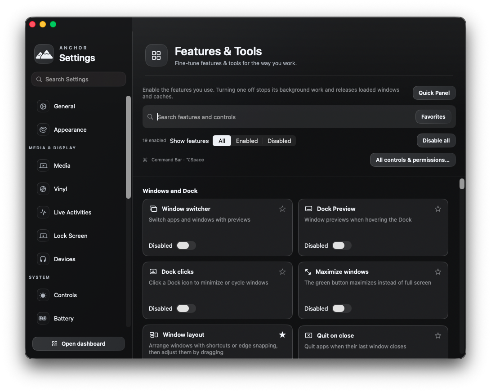

# Feature power controls — October 20, 2026

The 77-feature **Features & Tools** library now has explicit Enable switches, Enabled/Disabled filters, an enabled count and Disable all. Optional library features start off for a new profile. Existing profiles retain their enabled features and saved configuration.

## Runtime behavior

- An off feature is skipped at launch. Switching it off runs its shutdown binding immediately: registered shortcuts, event hooks, sampling, scheduled work and active tool windows stop as applicable.
- Disabled favorites and direct actions open the library at the matching Enable switch. They do not silently enable a tool. Enabling the Dynamic Island does not enable its extensions; each extension remains an explicit choice.
- Seventeen memory-heavy services use lazy, releasable ownership instead of a process-long strong singleton. Disabling their last owner releases the service and its loaded data. Shared capture, recording and package services remain while another enabled feature uses them.
- Closed utility window trees, image thumbnails, clipboard caches, process/port lists, update lists, package metadata and loaded Scratchpad documents are released when their owning features are disabled. Stored documents, history, files, favorites and preferences remain on disk.
- Scratchpad and clipboard history flush writes before shutdown. A save failure keeps recoverable edits in memory and refuses the feature switch. Active package transactions, app removals and cleanup operations must finish before disabling their feature.
- Stale clipboard save completions cannot write a freed, empty in-memory history back to disk or sweep images belonging to saved entries. Storage-only tests use disposable history files and never access the real pasteboard.
- Stable low-level system bridges keep their singleton identity because some OS callbacks use unretained pointers. Their activity stops immediately; the library offers a restart when remaining shared memory can be unloaded. Core Anchor features continue according to their own existing settings.
- No production polling loop or repeating timer was added. The 5 ms timer used to verify real scheduled-work shutdown exists only in a test fixture.

## Automated validation

All **32 package XCTest cases pass**, including 11 resource lifecycle cases. These verify cold disabled startup, actual timer shutdown and engine deallocation, last-owner release, concurrent construction, rapid disable/re-enable, disabled actions, explicit extension opt-in, successful history persistence after queued saves, and preservation of unsaved edits when storage fails. The existing imported behavioral suites also pass **21,913 checks**. Those synthetic checks are not claims of physically exercising every hardware feature.

Signed Debug compilation and strict bundle-signature verification pass. The live development app passed master-switch changes, All/Disabled filtering, Disable all (all 77 persisted gates off), an empty Quick Panel, and a cold relaunch with those choices still off. Global key events also passed enabled → disabled → enabled cycles using a temporary, unclaimed shortcut; the temporary key was a launch argument and was never saved. The original 19-feature development profile was restored afterward.

The default Option-Space check encountered a real registration conflict while Vorssaint Developer was also running. Anchor displayed “Choose an available Command Bar shortcut.” That check is not reported as passing; the lifecycle check used the isolated temporary combination instead. No other application's settings or process were changed. An attempted cross-process Carbon registration probe was inconclusive and is excluded from validation evidence.

All live checks use Accessibility actions and targeted or global keyboard events. They do not move the real pointer, invoke a screen lock, start a recording, open the camera, run a cleaner or perform a package transaction. Two early search-automation retries appended query text because synthetic Command-A did not select it; the final harness selects the field's Accessibility text range and verifies its contents before acting.

## Installed validation

The signed Release build is installed at `/Applications/Anchor.app`, and Launch Services resolves that path. Exactly one production copy is running and no development copy remains. Deep strict signature verification passes. The built and installed main executable hashes match:

`535caeaaa2e0578df65e7fe16df7f45aff62f68c5ac8c21ff50d7b1d6eaaf784`

The prior installed app is backed up at `/private/tmp/anchor-feature-power-install.iPWbXH/Anchor.previous.app` (prior executable hash `792c65f9426aa26b3688b69f46b5be29211f6e66e98c5d3240aed5acbfffdde9`). All 77 persisted feature availability values match the original production profile after testing, including its 19 enabled features.

The installed app passed Command Bar and Quick Launcher disable/re-enable/open checks. Quick Panel regression checks pass for close-button hit targeting at the notch overlap and after switching apps, regaining focus, closing while inactive, Escape, Command-W, section switching, fitting a tall section on the current display, restoring a minimized panel, and opening Controls without leaving the floating panel in front.

The first hit test was blocked by a stale Anchor AI Keychain dialog left by the earlier development process. The request was denied without granting access or changing saved keys, and the final checks ran without that dialog. The focus harness activates the app before raising its panel; raising an inactive panel and then activating the app can select the native Settings window instead. This models an explicit window focus request without moving the pointer.

## Idle measurements

Measurements use `scripts/measure.sh` with closed primary windows and no build running. Both profiles have the same 19 enabled library features. Each sample covers 29 observations over 60 seconds.

| Sample | Mean CPU | Median / p90 CPU | Mean / maximum RSS | Process age |
|---|---:|---:|---:|---|
| Before installation | 0.30% | 0.00% / 0.48% | 36.0 / 37.2 MB | Over ten hours |
| After installation | 0.12% | 0.00% / 0.48% | 183.4 / 209.5 MB | About seven to eight minutes, after live UI checks |

RSS includes shared code, allocator caches and pages that macOS can compress or reclaim after inactivity. A newly launched app and a long-running compressed app are not a controlled memory comparison. No percentage reduction is claimed. The lifecycle tests verify actual service deallocation and stopped scheduled work; savings depend on which enabled feature was doing work or retaining data. Some stable shared bridges finish unloading at restart.

The machine-readable receipt is [FEATURE-POWER-VALIDATION-2026-10-20.json](FEATURE-POWER-VALIDATION-2026-10-20.json).
