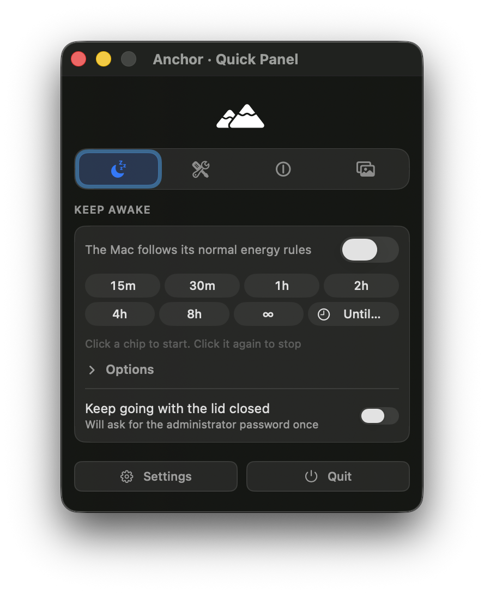

# Quick Panel focus and closing — October 19, 2026

The Quick Panel used an ordinary window at level 0. Anchor's notch occupies a larger transparent window at level 27. When the panel was near the top of the display, that transparent window covered the title bar. A screen-coordinate Accessibility hit test at the close button returned the notch's group instead of the close button. The close action itself still worked through Accessibility.

## Changes

- A dedicated native panel sits at level 28, above the notch. It remains visible when another app is active and accepts keyboard focus when raised.
- The normal close button, Escape and Command-W close it. Escape leaves an attached child dialog intact. Reopening also restores a minimized panel.
- The initial window has a real content size before centering. Content height uses the panel's current display, includes its title bar and leaves a 16-point margin. Larger sections scroll within that space; resize and display-change notifications keep the full window visible.
- Closing suspends panel-only metric sampling. Reopening refreshes sampling and the panel's visible state even though AppKit retains the hosted SwiftUI view.
- Opening Controls dismisses the floating panel after retaining the Controls window, so it does not cover those controls or briefly remove Anchor from the Dock.

## Checks

All 21 package XCTest cases pass, including five new native window cases. The live development app passed screen-coordinate close-button targeting at the original overlap, targeting after switching to Finder, restoring keyboard focus, close/reopen, Escape, Command-W, section switching and fitting a tall section completely on the display.

These interaction checks use Accessibility actions and keyboard events directed to Anchor. They never move the real pointer or trigger a lock. The initial development retry was interrupted by a macOS SecurityAgent dialog; that run was rejected, and the completed run passed after the dialog was gone.

## Installed result

The signed Release build was installed and launched at `/Applications/Anchor.app` as `com.arronlingham.Anchor` (PID 84114). Launch Services resolves that exact path, with one running copy and no development copy. Deep strict signature verification passes after the interaction checks. The built and installed executable hashes match:

`792c65f9426aa26b3688b69f46b5be29211f6e66e98c5d3240aed5acbfffdde9`

The installed app passed the same hit-target, focus, close/reopen, keyboard and display-fit checks, plus closing while another app is active, restoring a minimized panel and opening Controls without leaving the floating panel over it. It also worked as the only primary window: closing it returned Anchor to accessory mode, and reopening restored regular mode and focus. The working panel was left open at the center of the display.

The prior app is preserved at `/private/tmp/anchor-quick-panel-install.ws2l92/Anchor.previous.app`. Usage figures in the original feature-port report describe the earlier integration build, not this UI follow-up. No new polling or repeating timer was added.

