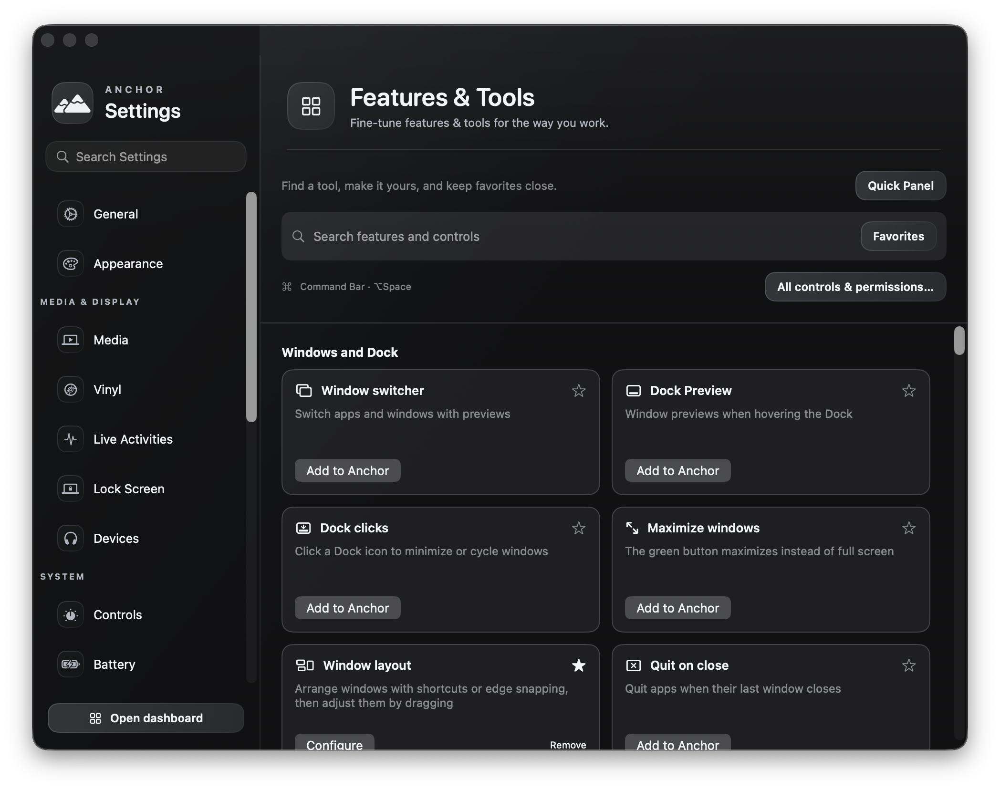

# Vorssaint feature research and Anchor integration

Research date: 2026-10-19. Implementation target: `/Users/arronlingham/projects/Anchor`.

## Sources and scope

The supplied repository is a native Swift application, not a web wrapper. Its working tree is an older Anchor-in-Vorssaint fork at `7a8a26493286f1e23d2460286d4b91a9cf290372` with local notch edits. It was read as reference and left unchanged. Its `ANCHOR-PORT.md` describes an earlier port in the opposite direction; those instructions were not applied to this project.

The [official latest release](https://github.com/vorssaint/vorssaint-utils/releases/tag/v3.4.1) was also checked. The implementation uses the released v3.4.1 source at `aea106cb5d52045c99810cf672da891d2a20b67d`, including additions absent from the supplied older fork. [Official source](https://github.com/vorssaint/vorssaint-utils/tree/aea106cb5d52045c99810cf672da891d2a20b67d), [product site](https://vorssaint.com).

The released catalog contains 77 feature areas. The full native services, settings, editors and supporting models are included in the local `AnchorUtilities` library. This is a GPL-compatible source port with preserved attribution, not a set of mock feature tiles. `Packages/AnchorUtilities/UPSTREAM.json` records original source hashes; `NOTICE.md` and `LICENSE` preserve provenance. Original brand images, promotional windows and the upstream application delegate are not used.

## Product integration

- **Discover and configure:** menu bar → Features & Tools; Anchor Settings → Features & Tools; Launchpad searches every feature.
- **Dashboard:** optional Favorite tools card, with favorites chosen in the library. Menu, Dashboard and Browse all features routes reach the same favorite chooser; All controls & permissions opens the detailed utility settings separately. Existing per-tab customization and task priorities remain intact.
- **Fast actions:** Command Bar defaults to Option-Space, with configurable shortcuts and visible registration errors. Capture/editing/file tools are available on demand. Background input replacements wait for the user to add and configure them.
- **One owner per control:** input filters, window switching/snapping, clipboard capture, per-app audio, URL cleanup, microphone selection and island presentation hand over to the selected engine. Saved classic choices restore when their replacement leaves. Choosing a classic control hands it back.
- **Microphones:** classic and advanced microphone controls use one mute backend, including soft-volume fallback and device reconnection handling.
- **Lock behavior:** only an explicit lock phrase is eligible in Command Bar, and locking requires confirmation. No corner movement or real lock was used in automated verification. The existing bottom-left macOS hot corner is unchanged. Lock-screen media and sounds hand over separately when those compact-island options are enabled.
- **Storage:** utility preferences use `<Anchor bundle identifier>.utilities`; user data lives under the app's private Application Support container in `Utilities/`. Explicit AppStorage stores, default parameters, first-install writes and migration readers use this domain.
- **Lifecycle:** Anchor owns the main application, menu and Dock presence. Optional metric status items share the utility lifecycle without a second app icon. Disabled features do not start their background bindings.
- **Support components:** Now Playing and fan-control support build with the app. The released agent price list ships in the package resource bundle, with its original hash recorded and its decoder tested, so token-value estimates do not require an initial download. Fan authorization identifies Anchor's development team and bundle; closed-lid rules use Anchor-specific names and never remove Vorssaint's rules. Installation or authorization is requested only by the corresponding user action.
- **Startup:** passive assistant credential checks run away from the main thread without authorization prompts. Explicit Load saved keys handles authorization; locked keys cannot be mistaken for a new empty account when adding keys.
- **Updates:** installed-application updates use the new App Updates tool. Upstream Vorssaint/Atoll self-updaters are blocked so they cannot replace Anchor.

## End-to-end workflow coverage

**Capture and media.** Shared area/window/screen selector, frozen selection, pixel loupe, OCR/QR, color formats, scrolling capture, timers, preview actions, annotation/crop/redaction/background/watermark editing, pinning, file/clipboard export, recent captures and explicit temporary sharing. Recording includes region/window/full-screen capture, separate microphone/system tracks, pause/resume, cursor/typing tracks, trim/cut/crop/zoom/blur/background editing, audio-level editing, export and GIF conversion. Image/video batch processing and reusable profiles use the native media pipeline.

**Windows and input.** Window/app switcher, multi-window thumbnails, search and rules; Dock previews/click behavior; maximize/restore; snapping, configurable zones, gaps, display movement and pointer gestures; close/quit protection; per-app exceptions; wheel smoothing/linear/horizontal/inverted scrolling; side buttons and gestures; middle click and debounce; snippets, variables, library and Super key.

**Files and everyday tools.** Clipboard items/pins/search/edit/paste, auto-clear privacy triggers, plain paste, Finder move/rename/image paste, URL cleaning, drag shelf/share, disk image installer, named Markdown scratchpads, camera mirror, custom radial profiles/submenus, Command Bar app/menu/window/file/script/calculation/conversion/emoji actions, quick toggles, Homebrew, app updates, cleanup with review/retention/organization, uninstall leftovers, processes, ports and wallpapers.

**Sound, display and power.** Per-app gain/boost/routing and exact percentages; device priority, output cycling and microphone controls; Music autolaunch blocking; display/keyboard brightness and XDR headroom; per-display on/off; keep-awake timers/automation/closed-lid support; sleep Bluetooth restoration.

**Island and monitoring.** Compact island on notched and unnotched displays, multiple displays, optional lock-screen presentation, media/lyrics/queue/levels, calendar/countdowns, timers, notifications, accessory/download states, agent usage, window-region watches and companion; CPU/GPU/memory/swap/temperature/network/disk/power/device/fan readouts, history, menu bar configuration, process details and alerts.

## Feature-by-feature map

Each row is backed by the native library. “Run” means a direct tool action; other rows open their feature's complete configuration or workspace. Permission names describe capabilities a feature can request, not permissions silently granted by this change.

### Windows and Dock

| Feature | Workflow | Native entry point | Settings | Permissions |
|---|---|---|---|---|
| Window switcher | Switch apps and windows with previews | [switcher](../Packages/AnchorUtilities/Sources/AnchorUtilities/Services/Switcher/AppSwitcher.swift) | `switcher` | accessibility, screenRecording |
| Dock Preview | Window previews when hovering the Dock | [dockPreview](../Packages/AnchorUtilities/Sources/AnchorUtilities/Services/DockPreview/DockPreviewService.swift) | `dock` | accessibility, screenRecording |
| Dock clicks | Click a Dock icon to minimize or cycle windows | [dockClick](../Packages/AnchorUtilities/Sources/AnchorUtilities/Services/DockClick/DockClickService.swift) | `dock` | accessibility |
| Maximize windows | The green button maximizes instead of full screen | [windowMaximizer](../Packages/AnchorUtilities/Sources/AnchorUtilities/Services/WindowMaximizer.swift) | `windowLayout` | accessibility |
| Window layout | Arrange windows with shortcuts or edge snapping, then adjust them by dragging | [windowLayout](../Packages/AnchorUtilities/Sources/AnchorUtilities/Services/WindowLayout/WindowLayoutService.swift) | `windowLayout` | accessibility |
| Quit on close | Quit apps when their last window closes | [autoQuit](../Packages/AnchorUtilities/Sources/AnchorUtilities/Services/AutoQuit/AutoQuitService.swift) | `autoQuit` | accessibility |
| Keep Spaces in a fixed order | Stops macOS from rearranging Spaces by most recent use, so they stay in the order you set. Your previous setting returns when this is turned off. The Dock may restart once to apply the change. | [spacesOrder](../Packages/AnchorUtilities/Sources/AnchorUtilities/Services/SpacesOrder/SpacesOrderHold.swift) | `dock` | None |

### Mouse and keyboard

| Feature | Workflow | Native entry point | Settings | Permissions |
|---|---|---|---|---|
| Invert mouse scrolling | Invert the mouse wheel direction | [scrollInverter](../Packages/AnchorUtilities/Sources/AnchorUtilities/Services/ScrollInverter.swift) | `mouse` | accessibility |
| Scroll sideways while holding a key | Hold only the selected modifier to scroll the vertical mouse wheel horizontally. Other key combinations are unchanged. | [scrollHorizontal](../Packages/AnchorUtilities/Sources/AnchorUtilities/Services/ScrollInverter.swift) | `mouse` | accessibility |
| Focus follows mouse | Focuses the window under the pointer. | [focusFollowsMouse](../Packages/AnchorUtilities/Sources/AnchorUtilities/Services/FocusFollowsMouse/FocusFollowsMouseService.swift) | `mouse` | accessibility |
| Smooth scrolling | Smooth, animated mouse scrolling | [smoothScroll](../Packages/AnchorUtilities/Sources/AnchorUtilities/Services/SmoothScrollService.swift) | `mouse` | accessibility |
| Linear scrolling | Every notch of the mouse wheel scrolls the same distance, no matter how fast it spins. The trackpad is not affected. | [linearScroll](../Packages/AnchorUtilities/Sources/AnchorUtilities/Services/ScrollInverter.swift) | `mouse` | accessibility |
| Disable mouse acceleration | Removes pointer acceleration for connected mice. Your previous setting returns when this is turned off or Anchor quits. | [mouseAcceleration](../Packages/AnchorUtilities/Sources/AnchorUtilities/Services/MouseAcceleration/MouseAccelerationService.swift) | `mouse` | None |
| Side buttons | Side mouse buttons go back and forward | [mouseNavigation](../Packages/AnchorUtilities/Sources/AnchorUtilities/Services/MouseNavigation/MouseNavigationService.swift) | `mouse` | accessibility |
| Mouse button shortcuts | Extra buttons and side-wheel directions press a key combination you choose. | [mouseButtonShortcuts](../Packages/AnchorUtilities/Sources/AnchorUtilities/Services/MouseButtons/MouseButtonShortcutService.swift) | `mouse` | accessibility |
| Trackpad middle click | Three finger click acts as a middle click | [middleClick](../Packages/AnchorUtilities/Sources/AnchorUtilities/Services/MiddleClick/MiddleClickService.swift) | `mouse` | accessibility |
| Extra click filter | Ignores rapid extra clicks from worn mouse buttons without slowing normal clicks. | [mouseClickDebounce](../Packages/AnchorUtilities/Sources/AnchorUtilities/Services/MouseClickDebounce/MouseClickDebounceService.swift) | `mouse` | accessibility |
| Debounce | Ignore accidental double key presses | [keyboardDebounce](../Packages/AnchorUtilities/Sources/AnchorUtilities/Services/KeyboardDebounce/KeyboardDebounceService.swift) | `keyDebounce` | accessibility |
| Text snippets | Short triggers expand into full text | [textSnippets](../Packages/AnchorUtilities/Sources/AnchorUtilities/Services/Snippets/TextSnippetService.swift) | `textSnippets` | accessibility |
| Super key | Turns one key into the modifier combination you choose. | [superKey](../Packages/AnchorUtilities/Sources/AnchorUtilities/Services/SuperKey/SuperKeyService.swift) | `superKey` | accessibility |
| Quit & close protection | Protects ⌘Q and ⌘W from accidental presses | [quitWindowProtection](../Packages/AnchorUtilities/Sources/AnchorUtilities/Services/QuitProtection/QuitProtectionService.swift) | `quitProtection` | accessibility |

### Clipboard and files

| Feature | Workflow | Native entry point | Settings | Permissions |
|---|---|---|---|---|
| Clipboard | Keep a local history of what you copy | [clipboardHistory](../Packages/AnchorUtilities/Sources/AnchorUtilities/Services/Clipboard/ClipboardHistoryService.swift) | `clipboard` | None |
| Paste as plain text | Paste text without formatting | [pastePlain](../Packages/AnchorUtilities/Sources/AnchorUtilities/Services/QuickTools/PastePlainService.swift) | `clipboard` | accessibility |
| Cut & paste | Cut and paste files in Finder | [finderCutPaste](../Packages/AnchorUtilities/Sources/AnchorUtilities/Services/Finder/FinderCutPaste.swift) | `cutPaste` | accessibility, automationFinder |
| Rename shortcut | Rename the selected file or folder with a shortcut you choose. | [finderRename](../Packages/AnchorUtilities/Sources/AnchorUtilities/Services/Finder/FinderRenameService.swift) | `cutPaste` | accessibility |
| Shelf | Drop files on the menu bar to hold them | [shelf](../Packages/AnchorUtilities/Sources/AnchorUtilities/Services/Shelf/ShelfService.swift) | `shelf` | None |
| Clean URL | Copied links lose their tracking junk | [urlCleaner](../Packages/AnchorUtilities/Sources/AnchorUtilities/Services/URLCleanerService.swift) | `urlCleaner` | None |
| Disk image installer | Install the single app inside a disk image and clean up the download | [diskImageInstaller](../Packages/AnchorUtilities/Sources/AnchorUtilities/Services/DiskImageInstaller/DiskImageInstallerService.swift) | `features` | appManagement |

### Sound

| Feature | Workflow | Native entry point | Settings | Permissions |
|---|---|---|---|---|
| Volume mixer | Per-app volume, pinning and custom order | [mixer](../Packages/AnchorUtilities/Sources/AnchorUtilities/Services/Audio/AppVolumeMixer.swift) | `general` | audioCapture, accessibility |
| Output switcher | Cycle sound outputs with a shortcut | [soundOutputSwitcher](../Packages/AnchorUtilities/Sources/AnchorUtilities/Services/Audio/SoundOutputSwitcher.swift) | `general` | None |
| Audio device priority | Automatically use your preferred audio devices | [audioPriority](../Packages/AnchorUtilities/Sources/AnchorUtilities/Services/Audio/AudioInputDeviceManager.swift) | `general` | None |
| Mute microphone | Mute the microphone from anywhere | [micMute](../Packages/AnchorUtilities/Sources/AnchorUtilities/Services/QuickTools/MicMuteService.swift) | `quickTools` | None |
| Music app blocker | Block music launches from detected media keys | [musicBlock](../Packages/AnchorUtilities/Sources/AnchorUtilities/Services/Audio/MusicLaunchBlocker.swift) | `general` | accessibility |

### Energy and display

| Feature | Workflow | Native entry point | Settings | Permissions |
|---|---|---|---|---|
| Keep awake | Keep the Mac awake on demand | [keepAwake](../Packages/AnchorUtilities/Sources/AnchorUtilities/Services/KeepAwakeManager.swift) | `energy` | accessibility |
| Displays | Brightness and power controls for every display | [brightness](../Packages/AnchorUtilities/Sources/AnchorUtilities/Services/Display/BrightnessService.swift) | `energy` | accessibility |
| Extra brightness | Extra brightness on XDR displays | [extraBrightness](../Packages/AnchorUtilities/Sources/AnchorUtilities/Services/Display/ExtraBrightnessService.swift) | `energy` | None |
| Bluetooth on sleep | Switches Bluetooth off while the Mac sleeps, so headphones in a bag stop connecting to it. | [bluetoothSleep](../Packages/AnchorUtilities/Sources/AnchorUtilities/Services/Bluetooth/BluetoothSleepService.swift) | `energy` | None |

### Tools

| Feature | Workflow | Native entry point | Settings | Permissions |
|---|---|---|---|---|
| Quick panel | A floating panel with your favorite tools | [quickLauncher](../Packages/AnchorUtilities/Sources/AnchorUtilities/Services/QuickTools/QuickLauncherService.swift) | `quickTools` | None |
| Quick toggles | One-click actions like dark mode and Trash | [quickToggles](../Packages/AnchorUtilities/Sources/AnchorUtilities/Services/QuickTools/QuickTogglesService.swift) | `quickTools` | automationFinder |
| Color picker | Pick any color on screen | [colorPicker](../Packages/AnchorUtilities/Sources/AnchorUtilities/Services/QuickTools/ColorSamplerService.swift) | `screenshot` | None |
| Copy text from screen | Copy text or QR codes from anything on screen | [screenOCR](../Packages/AnchorUtilities/Sources/AnchorUtilities/Services/QuickTools/ScreenTextService.swift) | `screenshot` | screenRecording |
| Cleaning Mode | Lock keyboard and screen for cleaning | [cleaningMode](../Packages/AnchorUtilities/Sources/AnchorUtilities/Services/CleaningMode/CleaningModeManager.swift) | `quickTools` | accessibility |
| Media | Compress videos, images and GIFs | [mediaTools](../Packages/AnchorUtilities/Sources/AnchorUtilities/Services/Media/MediaService.swift) | `media` | None |
| Cleaner | Clear caches and junk files | [cleaner](../Packages/AnchorUtilities/Sources/AnchorUtilities/Services/Cleaner/JunkCleaner.swift) | `cleaner` | fullDiskAccess, filesAndFolders, notifications |
| Uninstaller | Remove apps and their leftovers | [uninstaller](../Packages/AnchorUtilities/Sources/AnchorUtilities/Services/Uninstall/AppUninstaller.swift) | `uninstaller` | fullDiskAccess, automationFinder |
| Homebrew | Keep Homebrew packages up to date | [homebrew](../Packages/AnchorUtilities/Sources/AnchorUtilities/Services/Homebrew/HomebrewManager.swift) | `homebrew` | automationTerminal, appManagement |
| App updates | Find and install updates for the apps you have | [appUpdates](../Packages/AnchorUtilities/Sources/AnchorUtilities/Services/AppUpdates/AppUpdatesService.swift) | `appUpdates` | notifications, appManagement |
| Screenshot | Captures an area, window or screen and annotates it | [screenshot](../Packages/AnchorUtilities/Sources/AnchorUtilities/Services/QuickTools/ScreenshotService.swift) | `screenshot` | screenRecording |
| Camera preview | Opens a floating mirror with your camera | [cameraPreview](../Packages/AnchorUtilities/Sources/AnchorUtilities/Services/QuickTools/CameraPreviewService.swift) | `quickTools` | camera |
| Radial menu | Opens a wheel of your favorite actions around the pointer | [radialMenu](../Packages/AnchorUtilities/Sources/AnchorUtilities/Services/RadialMenu/RadialMenuService.swift) | `radialMenu` | accessibility |
| Scratchpad | Floating pads for short-lived notes | [scratchpad](../Packages/AnchorUtilities/Sources/AnchorUtilities/Services/QuickTools/ScratchpadService.swift) | `quickTools` | None |
| Command Bar | One field that finds and runs everything the app does | [commandBar](../Packages/AnchorUtilities/Sources/AnchorUtilities/Services/CommandBar/CommandBarService.swift) | `commandBar` | accessibility |
| Screen recording | Records an area, window or screen and edits it afterwards | [screenRecorder](../Packages/AnchorUtilities/Sources/AnchorUtilities/Services/Recorder/ScreenRecorderService.swift) | `screenshot` | screenRecording, accessibility, audioCapture, microphone |
| Wallpaper | Pick a still wallpaper without opening System Settings | [wallpaper](../Packages/AnchorUtilities/Sources/AnchorUtilities/Services/Wallpaper/WallpaperService.swift) | `quickTools` | None |
| Kill Process | Search running processes and force quit, restart, or kill process trees | [killProcess](../Packages/AnchorUtilities/Sources/AnchorUtilities/Services/KillProcess/KillProcessService.swift) | `killProcess` | None |
| Port Manager | View active listening ports and, with Kill Process installed, terminate the processes using them | [portManager](../Packages/AnchorUtilities/Sources/AnchorUtilities/Services/PortManager/PortManagerService.swift) | `portManager` | None |

### Dynamic Island

| Feature | Workflow | Native entry point | Settings | Permissions |
|---|---|---|---|---|
| Dynamic Island | Your music, controls and everyday tools, together at the top of your screen. Optional. Turn it off to keep using the separate panels. | [notch](../Packages/AnchorUtilities/Sources/AnchorUtilities/Services/Notch/NotchService.swift) | `notch` | accessibility, automationPlayback |
| Calendar | Browse the month and your upcoming appointments in the Dynamic Island. | [notchCalendar](../Packages/AnchorUtilities/Sources/AnchorUtilities/Services/Notch/NotchCalendarService.swift) | `notch` | calendar |
| Notifications | New system notifications in the Dynamic Island. | [notchNotifications](../Packages/AnchorUtilities/Sources/AnchorUtilities/Services/Notch/NotchNotificationService.swift) | `notch` | accessibility |
| Dynamic Island Gestures | Open and close the Dynamic Island with scrolling, and swipe to change tracks. | [notchGestures](../Packages/AnchorUtilities/Sources/AnchorUtilities/Services/Notch/NotchService.swift) | `notch` | None |
| Timer | Timers, a stopwatch and focused work sessions in the Dynamic Island. | [notchTimer](../Packages/AnchorUtilities/Sources/AnchorUtilities/Services/Notch/NotchTimerService.swift) | `notch` | None |
| Accessory alerts | Show connected accessories and warn once when their battery falls to 20%. | [notchAccessories](../Packages/AnchorUtilities/Sources/AnchorUtilities/Services/Notch/NotchAccessoryService.swift) | `notch` | None |
| Lyrics | Follow the lyrics of the current song in the Dynamic Island. | [notchLyrics](../Packages/AnchorUtilities/Sources/AnchorUtilities/Services/Notch/NotchLyricsService.swift) | `notch` | None |
| Up next | See the actual upcoming songs shared by your player. | [notchQueue](../Packages/AnchorUtilities/Sources/AnchorUtilities/Services/Notch/NotchMusicService.swift) | `notch` | None |
| Bars follow the music | Move the Dynamic Island bars with the sound your player makes. | [notchLiveEqualizer](../Packages/AnchorUtilities/Sources/AnchorUtilities/Services/Notch/NotchAudioLevelService.swift) | `notch` | audioCapture |
| Downloads | See files arriving in a folder you choose, directly in the Dynamic Island. | [notchDownloads](../Packages/AnchorUtilities/Sources/AnchorUtilities/Services/Notch/NotchDownloadService.swift) | `notch` | filesAndFolders |
| AI Agents | Follow plan limits, tokens, API value and the work in progress of Claude, Codex, OpenCode and GitHub Copilot in the Dynamic Island. | [notchAgents](../Packages/AnchorUtilities/Sources/AnchorUtilities/Services/AgentUsage/AgentUsageService.swift) | `notch` | None |
| Watch | Turn any part of any window into a live activity in the Dynamic Island, with an alert when it changes, finishes or shows what you are waiting for. | [notchWatch](../Packages/AnchorUtilities/Sources/AnchorUtilities/Services/Notch/NotchWatchService.swift) | `notch` | screenRecording, notifications |
| Companion | A little friend in the Dynamic Island who says hello now and then and reacts to what happens on your Mac. | [notchMascot](../Packages/AnchorUtilities/Sources/AnchorUtilities/Services/Notch/NotchMascotSupport.swift) | `notchMascot` | None |

### System monitor

| Feature | Workflow | Native entry point | Settings | Permissions |
|---|---|---|---|---|
| CPU | Processor usage and temperature | [monitorCPU](../Packages/AnchorUtilities/Sources/AnchorUtilities/Services/SystemMonitor/SystemMonitor.swift) | `monitor` | notifications |
| GPU | Graphics usage and temperature | [monitorGPU](../Packages/AnchorUtilities/Sources/AnchorUtilities/Services/SystemMonitor/SystemMonitor.swift) | `monitor` | None |
| Memory | Memory use and pressure | [monitorMemory](../Packages/AnchorUtilities/Sources/AnchorUtilities/Services/SystemMonitor/SystemMonitor.swift) | `monitor` | notifications |
| Network | Network speed and usage | [monitorNetwork](../Packages/AnchorUtilities/Sources/AnchorUtilities/Services/SystemMonitor/SystemMonitor.swift) | `monitor` | None |
| Disks | Disk space and activity | [monitorDisk](../Packages/AnchorUtilities/Sources/AnchorUtilities/Services/SystemMonitor/SystemMonitor.swift) | `monitor` | notifications |
| Power | Battery, power and charging | [monitorPower](../Packages/AnchorUtilities/Sources/AnchorUtilities/Services/SystemMonitor/SystemMonitor.swift) | `monitor` | notifications |
| Connected Devices | Count connected external USB peripherals | [connectedDevices](../Packages/AnchorUtilities/Sources/AnchorUtilities/App/FeatureRuntime.swift) | `monitor` | None |
| Fan Control | Control fans manually or with temperature curves while seeing live and target RPM | [fanControl](../Packages/AnchorUtilities/Sources/AnchorUtilities/Services/FanControl/FanControlService.swift) | `monitor` | None |

## Verification and practical limits

Automated validation covers the catalog/destination map, preference isolation, first-install choice preservation, explicit power-command intent, privileged identity separation, control handover, imported behavioral regressions, build/signing and offscreen UI rendering with generated media. The visual harness generates its own movie/image and never moves the pointer, captures a real display or calls lock.

Live hardware actions still require hands-on checks on the relevant devices and user-granted permissions: real recording with both audio sources, camera/Continuity Camera, physical monitor brightness/disconnect, Bluetooth sleep/wake, fan authorization/curves, and lock/unlock presentation and sound timing. Temporary sharing needs a real server round trip and is initiated only by Share. Per-app AirPlay uses upstream's macOS availability guard and is not represented as supported on older systems.

### Validation results

- **Package:** 21 XCTest cases pass, including nine integration cases, five native Quick Panel window cases and seven behavioral suites. The imported suites contain 21,913 checks: audio priority, capsule alignment, companion geometry, image/media processing, metrics, focus history and real recording exports with generated media.
- **Recording exports:** 103 checks pass through the production exporter. Generated video and separate synthetic system/microphone tracks verify timing offsets, silence, gain, trims/cuts, speed changes, blur coverage, GIF output and a private pasteboard. The test never captures a real display or microphone and never changes the user's clipboard.
- **Native regressions:** 416 switcher/Dashboard/launcher/lock-event checks; 106 productivity checks; 29 ownership checks; 24 credential checks; and the audio, lifecycle, settings-search, section-index, DSP, volume, launcher, shortcut, display-event and profile-recovery harnesses all pass. These are targeted checks, not a claim that every hardware workflow was exercised.
- **UI:** 37 surfaces were rendered using generated images/video. Offscreen AppKit snapshots do not capture every layered sidebar/card/video surface, so live window screenshots and Accessibility checks separately verified the installed feature library, Dashboard favorites, all 11 card choices, and Quick Panel. The detailed capture/recording controls also responded in the live development build.
- **Shortcut:** an actual global Option-Space key sequence opened the installed app's Command Bar. Escape dismissed it without executing a command. Separate live development-build checks confirmed that short `s` and `screen` searches did not offer the lock action; `screen` can still find the harmless Lock Screen settings pane. An explicit `lock` search offered the confirmed lock action, which was never executed.
- **Media bridge:** the bundled Perl/Swift Now Playing bridge ran successfully and returned valid JSON. Its metadata values were not logged.
- **Build:** signed Release builds succeed with test instrumentation disabled. The final resource update exposed an Xcode incremental resource-signing mismatch; the reproducible [finalization script](../Packages/AnchorUtilities/Support/finalize-app.sh) reseals the host after the package bundle, and deep strict verification then passes. Use that step after a command-line build.
- **Installation:** `/Applications/Anchor.app` is running as `com.arronlingham.Anchor`. Built and installed hashes match for the executable, Now Playing library and optional fan helper. Both bundled resource hashes match the recorded release originals. The pre-fix application is backed up at `/private/tmp/anchor-quick-panel-install.ws2l92/Anchor.previous.app`; the earlier pre-integration backup remains at `/private/tmp/anchor-utilities-install/Anchor.previous.app`.
- **Executable SHA-256:** `792c65f9426aa26b3688b69f46b5be29211f6e66e98c5d3240aed5acbfffdde9`.
- **Hardware availability:** the catalog registers all 77 areas; Fan Control is correctly unavailable on this fanless Mac, so the detailed hub counts 76 supported areas. Its helper passes its non-hardware self-test.

The installed app's initial utility profile exposes 19 on-demand areas and keeps background replacements off. Adding/configuring features can change resource use. The original supplied reference folder was not modified.

### Resource usage

Both measurements used the existing native preferences with main windows closed. The new app had settled for more than 13 minutes and exposed the initial 19 on-demand areas, with background replacements off.

| Sample | Duration | Mean CPU | Median / p90 CPU | Peak CPU | Mean / peak RSS |
|---|---|---|---|---|---|
| Previous app, PID 67642 | 40 s | 0.40% | 0.48% / 0.48% | 1.86% | 16.0 / 43.7 MB |
| Initial integration before Quick Panel fix, PID 81301 | 60 s | 0.21% | 0.00% / 0.00% | 5.27% | 44.2 / 44.4 MB |

These are short local samples, not a benchmark of all 77 features active together. The new release also disables test instrumentation, so differences are not attributed solely to the feature port. An earlier 9.12% sample included uncontrolled visible/activity conditions and is excluded from this idle comparison. Launch Services resolves Anchor to `/Applications/Anchor.app`, with one running copy; the installed bundle still passes deep strict signature verification after launch.

### Quick Panel follow-up

The focus/closing bug and its targeted checks are documented in [Quick Panel fix](QUICK-PANEL-FIX-2026-10-19.md). The original window sat below Anchor's transparent notch window, which intercepted clicks on its title bar. The replacement is a focusable floating panel with close shortcuts and display-aware sizing.

### Installed library

