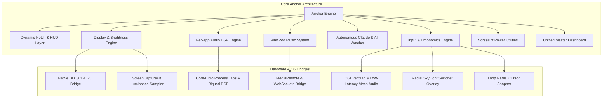
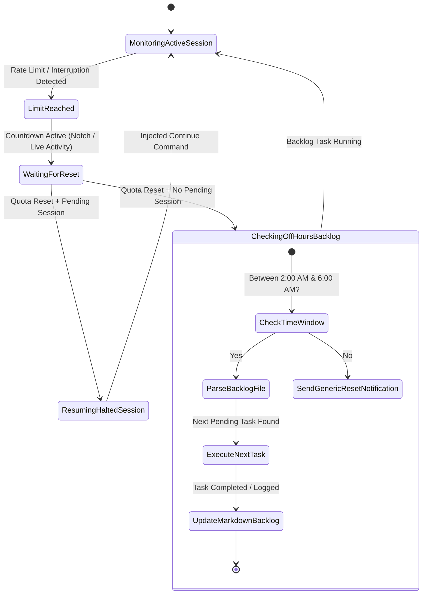
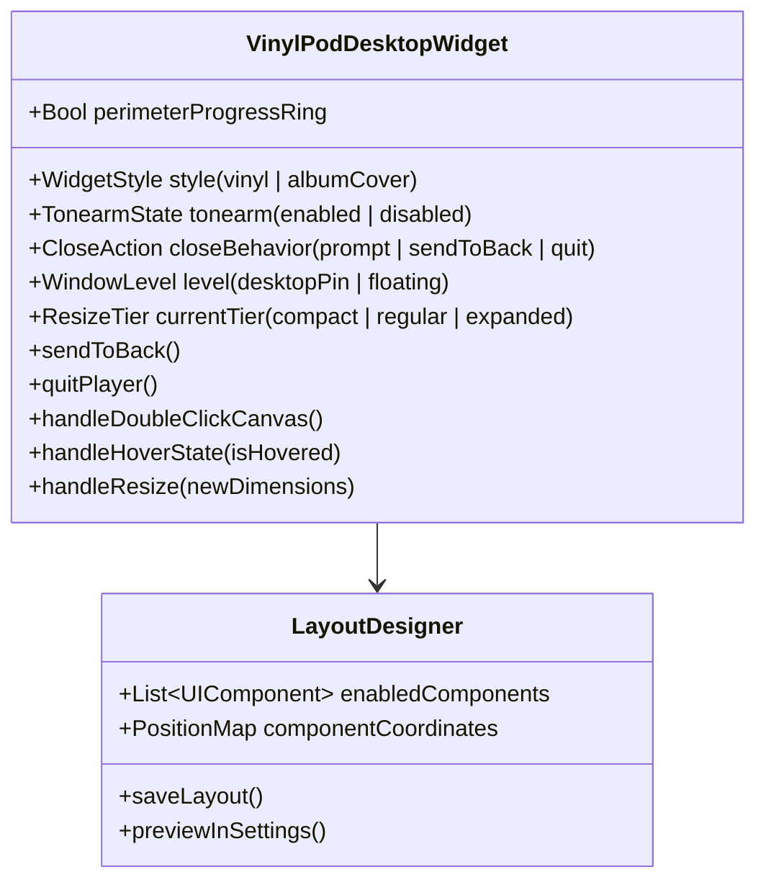
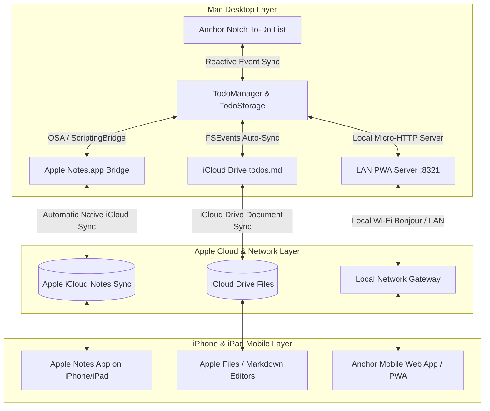
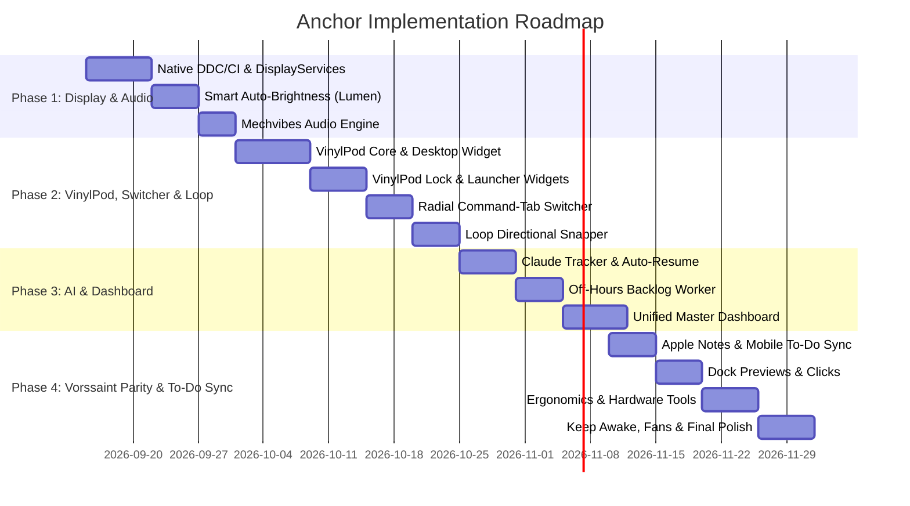

# ⚓️ Anchor — Master Feature Specification & Roadmap (`features.md`)

> **Comprehensive feature specification document for Anchor**, unifying the Dynamic Notch interface, VinylPod music player suite, Lunar-grade native display hardware control, FineTune-grade per-app audio DSP, autonomous developer AI quota automation, circular app switching, mechanical keyboard audio feedback, master control dashboard, and complete feature parity with Vorssaint.

---

## 📑 Table of Contents

1. [Executive Vision & System Architecture](#1-executive-vision--system-architecture)
2. [Smart Content-Aware Auto-Brightness Engine](#2-smart-content-aware-auto-brightness-engine)
3. [Autonomous Claude Usage Tracker & Off-Hours Auto-Continue Engine](#3-autonomous-claude-usage-tracker--off-hours-auto-continue-engine)
4. [VinylPod: Universal Music Player & Widget Ecosystem](#4-vinylpod-universal-music-player--widget-ecosystem)
   - [4.1 Lock Screen Player](#41-lock-screen-player)
   - [4.2 Launcher Music Widget](#42-launcher-music-widget)
   - [4.3 Desktop Floating Music Player Widget](#43-desktop-floating-music-player-widget)
5. [Radial Command-Tab App Switcher](#5-radial-command-tab-app-switcher)
6. [Loop: Directional Cursor-Aim Window Snapper](#6-loop-directional-cursor-aim-window-snapper)
7. [Mechvibes: Native Mechanical Keyboard Sound Engine](#7-mechvibes-native-mechanical-keyboard-sound-engine)
8. [Native External Display Hardware Control (Lunar In-App Replacement)](#8-native-external-display-hardware-control-lunar-in-app-replacement)
9. [Unified Master Dashboard (Control Center)](#9-unified-master-dashboard-control-center)
10. [Complete Vorssaint Feature Parity](#10-complete-vorssaint-feature-parity)
   - [10.1 Windows & Dock Enhancements](#101-windows--dock-enhancements)
   - [10.2 Mouse & Keyboard Ergonomics](#102-mouse--keyboard-ergonomics)
   - [10.3 Everyday Power Tools & System Utilities](#103-everyday-power-tools--system-utilities)
11. [Cross-Device To-Do Sync & Apple Ecosystem Integration (Notes & Mobile)](#11-cross-device-to-do-sync--apple-ecosystem-integration-notes--mobile)
   - [11.1 Native Apple Notes Two-Way Synchronization](#111-native-apple-notes-two-way-synchronization)
   - [11.2 Frictionless Mobile Access Pathways (iPhone & iPad)](#112-frictionless-mobile-access-pathways-iphone--ipad)
   - [11.3 iCloud Drive Markdown & JSON Mirroring](#113-icloud-drive-markdown--json-mirroring)
   - [11.4 Zero-Setup LAN Mobile Web App / PWA](#114-zero-setup-lan-mobile-web-app--pwa)
12. [Architecture, Preferences Registry & TCC Permissions](#12-architecture-preferences-registry--tcc-permissions)
13. [Implementation Phases & Milestone Roadmap](#13-implementation-phases--milestone-roadmap)

---

## 1. Executive Vision & System Architecture

Anchor is a high-performance, single-binary macOS utility hub engineered entirely in native Swift and SwiftUI. It replaces dozens of standalone Mac apps—such as Lunar, FineTune/SoundSource, Mechvibes, Codenotch, Lumen, rhubarb.bar, Bartender/Ice, WisprFlow, and window management utilities—while maintaining a median idle CPU footprint of `0.00%` and low resident memory.

### Guiding Principles
- **Native Swift & AppKit/SwiftUI:** Zero Electron runtimes, zero Node.js scripts, and zero background shell daemons.
- **Zero-Polling Guarantee:** All reactive features operate on operating system event streams (`IOKit`, `CoreAudio HAL`, `FSEvents`, `ScreenCaptureKit`, `CGEventTap`, `NSWorkspace`, `SkyLight`).
- **Hardware-Accelerated Rendering:** Visual widgets (such as the spinning VinylPod record and real-time audio visualizers) run via render-server Core Animation (`CALayer` / `CABasicAnimation`), keeping main-thread execution clear.
- **Unified Modular Preferences:** Every feature can be toggled, customized, or completely uninstalled dynamically without requiring an app relaunch.



---

## 2. Smart Content-Aware Auto-Brightness Engine

*Inspired by **Lumen** and **rhubarb.bar**, integrated natively with multi-display DDC/CI.*

### 2.1 Overview & Core Behavior
When using macOS in Dark Mode or at night, switching to a website or application with a bright white background (such as documentation, search engines, or un-themed web pages) causes harsh visual glare. The Smart Auto-Brightness Engine continuously evaluates on-screen luminance and dynamically adjusts monitor brightness down to protect your eyes, smoothly restoring brightness when dark content returns.

### 2.2 Key Features & Capabilities
- **Content-Aware Luminance Detection:**
  - Employs Apple's `ScreenCaptureKit` (`SCStream`) with hardware-accelerated, ultra-low-resolution frame sampling (e.g., 64×36 thumbnail buffer at 2–5 Hz).
  - Calculates the perceptual lightness ($L^*$ in CIELAB or root-mean-square perceived luminance) of the frontmost window or active display screen.
  - Detects "sudden white burst" events: triggers rapid, smooth dimming when luminance exceeds a configurable glare threshold while Dark Mode is active.
- **Internal & External Display Compatibility (rhubarb.bar Parity):**
  - Works simultaneously on built-in MacBook screens and external monitors.
  - Automatically targets the active display where the bright window is open, or synchronizes all monitors proportionally.
  - Direct hardware brightness writes via Apple `DisplayServices` (internal) and native `DDC/CI` (external).
- **Preference Learning Algorithm (Lumen Model):**
  - Automatically learns the user's brightness curve. If the user manually taps the brightness keys while viewing a specific light/dark ratio, the engine updates its regression model and remembers that preference for similar luminance levels in the future.
- **Adaptive Transition Smoothing:**
  - Non-linear sigmoid transition curve prevents abrupt flashing or jarring jumps.
  - Configurable ramp-down speed (fast response to glaring white) and gradual recovery speed (gentle return to normal brightness).
- **Application Exclusions & Rules:**
  - Per-app ignore list (e.g., Final Cut Pro, Lightroom, Photoshop, DaVinci Resolve, or full-screen video players) where auto-dimming is automatically suspended to maintain color accuracy.
  - Full-screen media detection (YouTube, Netflix, QuickTime) suspends luminance adjustments during playback.

---

## 3. Autonomous Claude Usage Tracker & Off-Hours Auto-Continue Engine

*Inspired by **Codenotch**, combined with autonomous recovery and off-hours backlog processing.*

### 3.1 Overview
A real-time usage monitor for Claude Code and coding assistants that tracks tokens, rate-limit reset windows, and session progress. It provides proactive autonomous recovery—resuming halted jobs upon limit reset and automatically executing tasks from an offline markdown backlog during off-hours.



### 3.2 Real-Time Token & Usage Monitoring
- **Multi-Source Token Acquisition (Codenotch Parity):**
  - Real-time `FSEventStream` monitoring of `~/.claude/projects` for active transcript updates, token counters, and warning banners.
  - Direct reading of Claude Desktop cached session responses and local CLI `/usage` reports.
  - Tracks 5-hour rolling rate-limit windows, weekly limits, and cost estimates.
- **Live Notch UI & Menu Bar Activity:**
  - Micro-ring status widget displaying current quota consumption percentage.
  - Hover tooltip card detailing time remaining until reset, token pace, and session state (*working*, *done*, or *waiting on user*).
  - External push alerts via `ntfy` to your mobile phone when limits are approaching or reset occurs.

### 3.3 Autonomous Session Resumption (Zero-User Intervention)
- **Automatic Interruption & Quota Recovery:**
  - When Claude Code encounters a rate limit (`resets 8:10pm`) or is interrupted, the watcher locks onto the target session, working directory, and transcript state.
  - When the reset timestamp triggers, Anchor automatically executes a resume/continue sequence in the target terminal/session, picking up the task without requiring the user to be present.
  - Guarded by a 3-repeat safety cap to prevent endless loops on recurring prompt errors.

### 3.4 Off-Hours Autonomous Task Backlog Engine
- **Scheduled Off-Hours Window (e.g., 2:00 AM – 6:00 AM):**
  - Defines a time frame where the user is unlikely to be actively working.
- **Autonomous Backlog Execution:**
  - If the rate limit resets during this window and no interrupted session exists to resume, the engine accesses a designated local markdown file (e.g., `tasks.md` or `BACKLOG.md`).
  - Reads pending task items (e.g., `- [ ] Implement user authentication tests`).
  - Automatically spins up Claude Code with the task description, working directory, and guidelines.
  - Updates the markdown document live, marking the task as `- [/] In Progress` and eventually `- [x] Completed` with git commit hashes and summary logs.
- **Configurable Fallback:**
  - If the backlog file is empty or missing, it outputs a clean notification or system log confirming quota reset and idle readiness.

---

## 4. VinylPod: Universal Music Player & Widget Ecosystem

*A unified, tactile music player with spinning vinyl physics, customizable liquid glass widgets, and multi-surface deployment across Lock Screen, Launcher, and Desktop.*

### 4.1 Lock Screen Player

The Lock Screen Player replicates Dynamic Island and iOS Live Activity controls on macOS, tailored for lock screen interaction.

#### 4.1.1 Small Widget Player (Toggleable)
- **Aesthetic:** Translucent **Liquid Glass** frosted materials (`NSVisualEffectView` with dynamic material blur and specular highlight borders).
- **Modular Component Customization:** Fully configurable layout unique to the small widget player. In Settings, users can enable, disable, and rearrange:
  - Previous Track Button
  - Play / Pause / Resume Button
  - Next Track Button
  - Scrolling Lyrics Snippet (one-line preview)
  - Scrubbable Progress Bar
  - Time Progressed (Elapsed)
  - Time Left (Remaining)
  - Artist Name
  - Song Title & Album Name
  - Miniature Spinning Vinyl or Square Album Thumbnail
- **Live Settings Preview:** Settings pane includes an interactive real-time preview reflecting changes immediately as components are added, removed, or shifted.

#### 4.1.2 Full-Screen Player (Toggleable)
- **Background Styling Options:**
  - *Album Cover Blurred Background:* Full-screen expansive artwork blur with subtle breathing animation.
  - *Blurred Dominant Color Gradient:* Multi-point mesh gradient sampled dynamically from the album artwork's palette.
- **Lyrics Front-and-Center Toggle:**
  - Instant toggle to disable lyrics, bringing album artwork and spinning vinyl into prominent center-stage focus.
  - When lyrics are enabled: synchronized line-by-line scrolling with tap-to-seek.
- **Vinyl Mode vs. Album Cover Mode:**
  - Toggle between photorealistic spinning vinyl disc or standard high-resolution square album cover.
  - **Tonearm ("Stick") Toggle:** Toggle realistic vinyl tonearm with smooth pivot animation onto the record groove on playback start/pause.
  - **Perimeter Progress Ring:** Optional circular glowing progress bar drawn directly around the outer circumference of the spinning vinyl record.
- **Modular Component Customization:** Independent toggle and layout controls unique to the Full-Screen player.

---

### 4.2 Launcher Music Widget (LaunchMe Integration)
- **Direct App Launcher Integration:** Embedded directly inside the LaunchMe Spotlight/Launchpad panel grid.
- **State Synchronization:** Fully linked to the active playback session (Apple Music, Spotify, YouTube Music, etc.).
- **Button Visibility Modes:**
  - *Always Visible:* Playback transport controls remain accessible at all times.
  - *Hover-Only:* Clean, minimalist display that reveals playback controls smoothly on cursor hover.
- **Fixed Size Presets:** Available in **Small** (compact badge), **Medium** (standard widget), and **Large** (expanded track card).
- **Visual Styles:** Choose between spinning vinyl (with or without tonearm) or square album artwork.
- **Circular Progress Ring:** Optional progress indicator surrounding the vinyl border.
- **Direct Interaction:** Clicking the widget smoothly expands into the full floating player or navigates to the music source.

---

### 4.3 Desktop Floating Music Player Widget

A dedicated floating or desktop-pinned widget providing interactive playback controls directly on your workspace.



#### 4.3.1 Window Lifecycle & Closing Dialog
- Clicking the window close button (`X`) presents an interactive choice modal:
  1. **Send to Back:** Depresses the player to the desktop wallpaper level (`kCGDesktopWindowLevel`), sitting behind all application windows without cluttering work.
  2. **Quit Player:** Completely terminates the music player window and tears down active render pipelines.
  - Option to set a default action and suppress future prompts.

#### 4.3.2 Visual & Record Customization
- **Styling Options:** Choose between spinning vinyl record and square album art.
- **Vinyl Physics & Details:**
  - Tonearm ("stick") toggle: choose tonearm on or off.
  - Progress bar around the vinyl rim: outer glowing circular track reflecting song progress.
- **Independent Customization:** Layout and component toggles are completely decoupled from Lock Screen and Launcher configurations.

#### 4.3.3 Desktop Mode Interactions & Drag-and-Drop Layout Designer
- **Double-Click Background:** Double-clicking any empty/non-interactive region of the widget instantly sends the widget to the desktop wallpaper layer.
- **Interactive Visual Layout Designer (in Settings):**
  - Visual drag-and-drop canvas allowing users to reposition buttons (Play, Pause, Next, Prev, Volume, Shuffle, Repeat) and metadata fields (Title, Artist, Album, Format badge) to custom coordinate anchors.
  - Live interactive preview in Settings reflects drag changes in real time.
- **Movable Time & Timer Toggle:** Detachable or repositionable playback timer/countdown module.

#### 4.3.4 Responsive Mouse Resizing & Content Adaptation
- **Interactive Mouse Resizing:** Resize handles on all borders and corners.
- **Adaptive Layout Rules (Preset Responsive Tiers):**
  - *Large Bounds:* Displays spinning vinyl with tonearm, full lyrics box, complete track metadata, scrubber, and full transport button bar.
  - *Medium Bounds:* Hides tonearm and lyrics; retains spinning vinyl, song title, artist, and primary controls.
  - *Small/Compact Bounds:* Automatically collapses into a sleek mini-pill, hiding album art and secondary metadata, focusing strictly on track title, mini-scrubber, and Play/Pause.

#### 4.3.5 Hover Dynamics & Button Overlays
- **Hover Expansion:** Widget can dynamically expand its bounds on cursor hover to reveal the full artist name, detailed waveform progress bar, and volume sliders.
- **Button Overlays:** Subtle, semi-transparent frosted button overlays appear over album art on hover for immediate playback control.
- **Quick Access:** Direct gear shortcut icon on hover opening VinylPod preferences directly.

---

## 5. Radial Command-Tab App Switcher

*A modern, ergonomic redesign of macOS application switching centered directly around the mouse cursor.*

### 5.1 Core Interaction Design
Standard macOS <kbd>⌘</kbd><kbd>Tab</kbd> presents a linear horizontal row centered on the primary display, often far from the cursor. Anchor redesigns this into a fluid, radial circle positioned immediately around the mouse pointer.

```
       [ App 1 ]
  [ App 6 ]   [ App 2 ]
      \     |     /
       • (Mouse)
      /     |     \
  [ App 5 ]   [ App 3 ]
       [ App 4 ]
```

### 5.2 Behavioral Specifications
- **Cursor Centering:** When <kbd>⌘</kbd><kbd>Tab</kbd> is pressed, the radial wheel anchors its center directly at the current cursor coordinates across any monitor.
- **Full macOS Muscle Memory Parity:**
  - Holding <kbd>⌘</kbd> and pressing <kbd>Tab</kbd> advances clockwise around the circle.
  - Holding <kbd>⌘</kbd> and pressing <kbd>⇧</kbd><kbd>Tab</kbd> steps counter-clockwise.
  - Releasing <kbd>⌘</kbd> immediately focuses and activates the highlighted application.
  - Pressing <kbd>Q</kbd> while holding <kbd>⌘</kbd> quits the selected application.
  - Pressing <kbd>H</kbd> hides the selected application.
  - Pressing <kbd>Esc</kbd> or <kbd>`</kbd> cancels switching without changing focus.
- **Seamless Mouse Usability:**
  - Moving the mouse highlights whichever slice/icon the pointer hovers over.
  - Clicking any icon immediately activates that application and dismisses the switcher.
  - Radial angle detection allows rapid, gesture-like flicks to select frequent apps.
- **Visuals & Performance:**
  - Liquid glass radial ring with high-resolution app icons and live badge counters.
  - Optional live window thumbnail previews inside the ring hub on hover.
  - Rendered using non-activating SkyLight overlay windows—never steals key focus during navigation.

---

## 6. Loop: Directional Cursor-Aim Window Snapper

*Inspired by **Loop** (`MrKai77/Loop`), bringing fluid radial and directional gesture window snapping directly to your mouse cursor.*

### 6.1 Core Concept & Gesture Interaction
- **Trigger-Key Hold:** Press and hold a dedicated modifier or trigger key (e.g., <kbd>Fn</kbd> / Globe, <kbd>Caps Lock</kbd>, <kbd>⌥</kbd>, or a customizable key combination).
- **Directional Mouse Aiming:** While holding the trigger key, simply move your mouse in any direction relative to where the trigger was initiated. The target snap zone highlights dynamically with an elegant visual preview:
  - **Left (←):** Snaps to Left Half (or Left 1/3, Left 2/3 via scroll wheel).
  - **Right (→):** Snaps to Right Half (or Right 1/3, Right 2/3 via scroll wheel).
  - **Top (↑):** Snaps to Top Half (or Maximize when pushed further upward).
  - **Bottom (↓):** Snaps to Bottom Half (or Center Window).
  - **Top-Left (↖):** Snaps to Top-Left Quarter.
  - **Top-Right (↗):** Snaps to Top-Right Quarter.
  - **Bottom-Left (↙):** Snaps to Bottom-Left Quarter.
  - **Bottom-Right (↘):** Snaps to Bottom-Right Quarter.
  - **Center Deadzone (•):** Maximize or Center window.
- **Instant Snap on Key Release:** Releasing the trigger key instantly snaps the frontmost window into the selected size and position with a smooth spring transition.
- **Zero Dragging Required:** Eliminate the tedious requirement to click and drag window title bars across entire multi-monitor setups. Position and resize windows instantly from anywhere on screen simply by flicking the cursor.

### 6.2 Visual HUD & Ghost Preview
- **Radial Cursor Overlay ("The Loop"):** An elegant, translucent circular indicator appears directly under the mouse cursor when the trigger key is held, showing the directional sectors (radial slices) and current active selection.
- **Live Ghost Preview Outline:** A semi-transparent liquid-glass preview rectangle highlights the exact screen dimensions the window will occupy before the key is released.
- **Customization & Themes:**
  - Configurable radial deadzone radius and trigger distance.
  - Accent color, stroke thickness, and corner radius matching Anchor's liquid glass design.
  - Haptic feedback (on supported trackpads) when crossing into different snap sectors.

### 6.3 Pro Controls & Multi-Monitor Support
- **Scroll Wheel Sizing Cycle:** Scrolling the mouse wheel while holding the trigger key cycles between half (1/2), one-third (1/3), two-thirds (2/3), and full-screen variants for the targeted direction.
- **Display Hopping:** Flicking the cursor across monitor boundaries instantly moves and snaps the window across multiple displays seamlessly.
- **Keyboard Parity:** While holding the trigger key, tapping arrow keys can also select snap zones without moving the mouse.

---

## 7. Mechvibes: Native Mechanical Keyboard Sound Engine

*Tactile acoustic mechanical switch feedback built natively into Anchor.*

### 7.1 Audio Synthesis Engine
- **Ultra-Low Latency CoreAudio Engine:**
  - Built with native `AVAudioEngine` and pre-allocated `AVAudioPlayerNode` sound buffers.
  - Audio latency below 3 ms: sound triggers synchronously with the physical keypress.
- **Event-Tap Interceptor:**
  - Global `CGEventTap` listening for keyboard events (`keyDown` and `keyUp`).
  - Distinct acoustic samples for **Key Down** (switch actuation / bottom out) and **Key Up** (switch reset / return).

### 7.2 Sound Packs & Customization
- **Preloaded Sound Pack Profiles:**
  - Cherry MX Blue (Audible click & bottom out)
  - Cherry MX Brown (Gentle tactile bump)
  - Cherry MX Red / Black (Smooth linear clack)
  - Topre Electro-Capacitive (Deep, muted "thock")
  - Holy Panda (Deep tactile clack)
  - IBM Model M (Buckling spring metallic ping)
  - Vintage Mechanical Typewriter
- **Mechvibes & MechvibesDX Soundpack Compatibility:**
  - Direct importer for custom soundpack folders containing `config.json` and audio files (`.wav`, `.ogg`, `.mp3`).
  - Automatically parses keycode maps and volume levels.
- **Ergonomic Safety & App Blacklists:**
  - Per-key pitch randomization (±1.5%) prevents synthetic, repetitive audio fatigue.
  - Microphone auto-ducking: automatically mutes or lowers keyboard sounds when the microphone is in active use (e.g., during Zoom, Google Meet, Discord, or dictation).
  - Application exclusions: automatically disable mechanical sounds in designated apps (e.g., Logic Pro, Ableton Live, games).

---

## 8. Native External Display Hardware Control (Lunar In-App Replacement)

*Direct hardware DDC/CI and DisplayServices control for external monitors built natively into Anchor—no external Lunar app required.*

### 8.1 Pure Native Communication Channels
Anchor integrates low-level display control directly into its binary, completely eliminating the need for third-party tools like Lunar or BetterDisplay:
1. **DDC/CI over I2C:**
   - Communicates with external monitors over DDC/CI (Display Data Channel Command Interface) via IOFramebuffer and Apple Silicon I2C interfaces.
   - Adjusts hardware brightness (VCP code `0x10`), contrast (`0x12`), and monitor speaker volume (`0x62`).
   - Packet verification and timeout protection: handles non-responsive or slow monitors gracefully without blocking the UI.
2. **Apple Native Display Services (`DisplayServices.framework`):**
   - Direct control for Apple displays (Studio Display, Pro Display XDR, LG UltraFine) using private CoreDisplay / DisplayServices APIs (`DisplayServicesSetBrightness`).
3. **Software Dimming & Sub-Zero Fallback:**
   - For monitors that do not support DDC/CI or are connected through incompatible docks/adapters:
   - Utilizes GPU gamma table manipulation or calibrated dark overlays to dim displays smoothly.
   - **Sub-Zero Brightness:** Enables dimming below the hardware minimum (below 0%), ideal for working in total darkness.

### 8.2 Core Display Capabilities
- **Unified Slider Controls:** Unified or per-display sliders in Anchor's menus, notch, and master dashboard.
- **Hardware Sensor Synchronization:** Matches external monitor brightness smoothly to the MacBook's built-in ambient light sensor.
- **Multi-Monitor Volume Keys:** Intercepts macOS keyboard volume and brightness keys (<kbd>F1</kbd>/<kbd>F2</kbd>, <kbd>F10</kbd>–<kbd>F12</kbd>) to drive external display hardware directly.

---

## 9. Unified Master Dashboard (Control Center)

*A unified, tactile command center bringing together display hardware, per-app audio DSP, VinylPod music playback, and system utilities in one comprehensive dashboard.*

```
+-------------------------------------------------------------------------+
|                          ⚓️ ANCHOR DASHBOARD                             |
+-------------------------------------------------------------------------+
| [ BRIGHTNESS CENTER ]     | [ VOLUME CENTER (FineTune) ]                |
| Built-in:  [====----] 52% | Master Output: [==========] 85% Headphone   |
| External:  [======--] 70% | - Spotify:     [======----] 70%  [Boost 2x] |
| [x] Smart Auto-Brightness | - Arc Browser: [====------] 40%  [Default]  |
| [x] Sub-Zero Dimming      | - Discord:     [========--] 80%  -> Speaker |
| [x] XDR Headroom Boost    | [x] 10-Band EQ  |  [x] AutoEQ Headphone     |
+---------------------------+---------------------------------------------+
| [ VINYLPOD MUSIC PLAYER ] | [ SYSTEM QUICK CONTROLS & UTILITIES ]       |
|  ((  O  ))  Song Title    | [Dark Mode]  [Keep Awake]  [Cleaning Mode]  |
|   Vinyl    Artist Name   | [Screen OCR] [Screen Rec]  [Mute All Mics]  |
| [|<] [ > ] [>|] [Lyrics]  | CPU: 12% | RAM: 14.2GB | Fan: 1850 RPM      |
| [================-------] | Claude Tokens: [====----] Resets in 1h 24m  |
+-------------------------------------------------------------------------+
```

### 9.1 Brightness Center (Lunar Class)
- Per-display brightness and contrast sliders for all connected displays.
- Quick toggles for Smart Content-Aware Auto-Brightness, Sub-Zero Dimming, and XDR Headroom Booster.
- Display link toggle (adjust all screens simultaneously).

### 9.2 Volume Center (FineTune Class)
- Master volume slider and instant audio output device routing selector.
- **Per-App Volume Sliders:** Individual volume controls with mute toggles for every running application.
- **Per-App Volume Booster:** Amplification presets (2×, 3×, 4× gain) for quiet media.
- **Per-App Audio Routing:** Route audio streams independently (e.g., Spotify to external speakers, Slack/Zoom to headphones).
- **10-Band Parametric Equalizer:** Visual curve EQ with 20 presets and AutoEQ headphone compensation profiles.
- **Dynamic Loudness Compensation:** ISO 226 low-volume contour compensation.
- **Microphone Management:** Input level meters and global microphone mute toggle.

### 9.3 VinylPod Music Center
- Embedded interactive VinylPod widget displaying real-time spinning vinyl artwork.
- Transport controls, scrubbable waveform/progress bar, and synchronized lyrics overlay toggle.
- Audio source selector (Apple Music, Spotify, YouTube Music, etc.).

### 9.4 System Quick Controls & Monitoring
- **Quick System Toggles:** One-click toggles for Dark/Light Mode, Keep Awake, Cleaning Mode, Screen Capture, Screen OCR, and Mic Mute.
- **Hardware Monitoring Metrics:** Live readouts for CPU %, GPU %, Memory pressure, Network upload/download speeds, Fan RPM, and Battery health.
- **Claude Tracker Mini-Card:** Live token usage bar, reset countdown timer, and quick backlog task status.

---

## 10. Complete Vorssaint Feature Parity

*Comprehensive enumeration of all capabilities from Vorssaint integrated into Anchor.*

### 10.1 Windows & Dock Enhancements

| Feature | Upstream Key | Detailed Behavior |
|---|---|---|
| **Dock Previews** | `dockPreview` | Hovering over any Dock icon displays live, interactive window thumbnails with titles. Clicking activates the window; dragging the thumbnail moves and snaps the window directly. |
| **Dock Click Actions** | `dockClick` | Clicking the Dock icon of an already active application triggers configurable actions: minimize all windows, hide application, or cycle through open windows. |
| **Window Maximizer** | `windowMaximizer` | Clicking the green title bar zoom button fills the entire display without transitioning into a separate macOS full-screen Space. Clicking again restores the original frame. |
| **Auto-Quit on Close** | `autoQuit` | Designated applications (e.g., System Settings, Utilities, Finder) automatically quit when their final window is closed. |
| **Quit & Close Protection** | `quitWindowProtection` | Protects <kbd>⌘</kbd><kbd>Q</kbd> and <kbd>⌘</kbd><kbd>W</kbd> against accidental presses via hold-to-confirm, double-press requirement, or supplementary modifier key. |
| **Advanced Window Layout** | `windowLayout` | Dragging window title bars to screen edges or corners presents a live snap preview outline. Supports modifier-drag anywhere on a window to move, plus Shift/Right-click to resize. Moving windows between displays preserves the relative entry half. |

### 10.2 Mouse & Keyboard Ergonomics

| Feature | Upstream Key | Detailed Behavior |
|---|---|---|
| **Mouse Scroll Inverter** | `scrollInverter` | Inverts vertical and horizontal mouse scroll wheel directions independently without altering the trackpad's natural scrolling behavior. |
| **Smooth Scrolling** | `smoothScroll` | Implements fluid inertia and momentum glide physics for mechanical mouse scroll wheels with configurable speed and friction curves. |
| **Mouse Pointer Acceleration** | `mouseAcceleration` | Toggle to disable macOS mouse cursor acceleration curves, enabling true 1:1 linear tracking for gaming and precision work. |
| **Mouse Side Buttons** | `mouseNavigation` | Enables standard browser/Finder Back and Forward navigation on auxiliary mouse side buttons (buttons 4 & 5). |
| **Mouse Button Shortcuts** | `mouseButtonShortcuts` | Maps custom key combinations to extra mouse buttons or side-wheel tilts, or drag gestures to switch Spaces and trigger Mission Control. |
| **3-Finger Middle Click** | `middleClick` | Translates a three-finger tap on the trackpad into a genuine middle mouse click event. |
| **Mouse Click Debounce** | `mouseClickDebounce` | Filters out rapid accidental double-clicks caused by worn mechanical microswitches without adding perceptible click latency. |
| **Super / Hyper Key** | `superKey` | Remaps Caps Lock or right-side modifier keys into a global Hyper modifier (<kbd>⌃</kbd><kbd>⌥</kbd><kbd>⌘</kbd><kbd>⇧</kbd>). Tapping on its own can send Escape, switch input sources, or toggle caps. |

### 10.3 Everyday Power Tools & System Utilities

| Feature | Upstream Key | Detailed Behavior |
|---|---|---|
| **Keep Awake Engine** | `keepAwake` | Prevents Mac sleep on a timer or conditional triggers (external monitor connected, power adapter plugged in). Supports clamshell mode (keeping Mac awake with lid closed). |
| **Cleaning Mode** | `cleaningMode` | Locks keyboard input and either blacks out all displays or shows a discreet indicator, allowing safe physical cleaning of keys and screens. |
| **Screen OCR & QR Code Reader** | `screenOCR` | Select any region of the screen to perform on-device text recognition (Vision framework) directly to clipboard, with automatic QR code parsing. |
| **Local Media Tools** | `mediaTools` | Built-in offline tools to compress video files, trim/crop clips, convert image formats in batches, generate GIFs, and strip metadata. |
| **Homebrew GUI Manager** | `homebrew` | Search, install, update, and uninstall Homebrew formulae and casks without opening the terminal. |
| **Universal App Updates** | `appUpdates` | Scans for software updates across Homebrew, Mac App Store (`mas`), and direct download releases in a single categorized view. |
| **Radial Menu** | `radialMenu` | Cursor-anchored wheel menu of favorite actions, apps, files, and scripts accessible via hotkey or mouse button. |
| **Floating Scratchpad** | `scratchpad` | Multi-tab floating notepad supporting Markdown rendering, auto-save, and automated expiration clearing. |
| **Advanced Screen Recorder** | `screenRecorder` | Records screen regions with split audio tracks (system audio and microphone), automatic cursor smoothing, click zooms, blur redaction, and GIF export. |
| **Finder Cut-and-Paste** | `finderCutPaste` | Enables genuine cut (<kbd>⌘</kbd><kbd>X</kbd>) and paste (<kbd>⌘</kbd><kbd>V</kbd>) for files in Finder, and allows pasting copied images directly as `.png` files. |
| **Finder F2 Rename** | `finderRename` | Standardizes file renaming in Finder using the <kbd>F2</kbd> key. |
| **Auto-Clear Clipboard** | `autoClearClipboard` | Automatically purges transient clipboard contents after a configurable timeout, or on display sleep, lock, or system sleep. |

### 10.4 Hardware, Power & Energy Management

| Feature | Upstream Key | Detailed Behavior |
|---|---|---|
| **Extra Brightness XDR Booster** | `extraBrightness` | Overrides standard macOS brightness ceilings on MacBook Pro Liquid Retina XDR displays, utilizing sustained HDR headroom to reach up to 1,600 nits in daylight. |
| **Bluetooth Sleep Automator** | `bluetoothSleep` | Automatically powers down the Bluetooth adapter when the Mac enters sleep, preventing sleeping laptops from hijacking wireless headphones. Restores state on wake. |
| **Manual Fan Control & Curves** | `fanControl` | Direct SMC fan controller providing continuous manual RPM sliders, custom multi-point temperature curves, and live RPM telemetry. |
| **Music App Blocker** | `musicBlock` | Prevents macOS from automatically launching the Apple Music app when Bluetooth headphones connect or play/pause is pressed. |

---

## 11. Cross-Device To-Do Synchronization & Apple Ecosystem Integration (Notes & Mobile)

> Verification update (2026-09-14): The Notes, iCloud Drive, PWA and Shortcuts pathways below are proposals, not implemented features. The implemented phone-editing route now uses a selected Apple Reminders list through EventKit. See `HANDOFF-VERIFICATION.md` for what was fixed, tested, and what still needs a device check.

*Seamless bi-directional synchronization of Anchor's to-do checklist with native Apple Notes, iCloud, and low-friction mobile companion access pathways for iPhone and iPad.*

### 11.1 Executive Vision & Problem Statement
Anchor's Notch To-Do tab provides instant, zero-friction task capture directly on macOS with rock-solid local persistence (`todos.json`). To ensure tasks captured on the Mac are easily accessible on the go—without forcing users into third-party cloud accounts, subscription fees, or separate desktop daemon installations—Anchor integrates directly with Apple's native **Notes app (`Notes.app`)** and iCloud ecosystem, alongside intuitive mobile companion pathways.



### 11.2 Native Apple Notes Two-Way Synchronization
- **Zero-Configuration Apple Notes Bridge:**
  - Establishes a real-time, event-driven link between Anchor's `TodoManager` and a designated note in the user's default iCloud account in `Notes.app` (default title: **"Anchor Checklist"**, customizable in Settings).
  - Uses native macOS Apple Events, Open Scripting Architecture (OSA), and `ScriptingBridge` (`Notes.framework`) without requiring network credentials or external APIs.
- **Native Checklist Format Parity:**
  - Every `TodoItem` in Anchor maps directly to an interactive Apple Notes checklist item (`- [ ]` checkbox block).
  - **Ticking on iPhone / iPad:** When the user ticks a checkbox inside Apple Notes on their phone, iCloud syncs the note to the Mac; Anchor's observer detects the change and marks the item done in Anchor.
  - **Ticking in Anchor Notch:** Checking an item in Anchor immediately toggles the corresponding checkbox in Apple Notes.
  - **Adding / Removing Items:** New items typed into the Notch appear in Apple Notes with proper order; new items added in Apple Notes automatically populate into Anchor.
- **Metadata Preservation:**
  - Preserves priority and custom due dates using unobtrusive, human-readable inline badges:
    - `📅 Due: Sep 20` or `📅 Today`
    - `🔴 High`, `🟠 Medium`, `🟡 Low`
  - When modified in Apple Notes, due date tags are parsed and update Anchor's date state accordingly.

### 11.3 Frictionless Mobile Access Pathways (iPhone & iPad)
In addition to the primary Apple Notes sync, Anchor specifies four user-friendly pathways to access, view, and manage to-dos on mobile devices:

#### Pathway 1: Native Apple Notes App (Primary Native Path)
- **Zero New Apps Needed:** Uses the pre-installed Apple Notes app already on every iPhone, iPad, and Apple Watch.
- **Interactive Widgets & Siri:**
  - Place Apple Notes checklist widgets on the iOS Home Screen and Lock Screen.
  - Ask Siri: *"Show my Anchor Checklist note"* or *"Add buy coffee to my Anchor note"*.
  - Full offline support with instantaneous iCloud background syncing.

#### Pathway 2: iCloud Drive Markdown & JSON Mirroring
- **Automatic Dual Mirroring:**
  - Whenever `TodoStorage` saves changes, it can mirror a human-readable checklist to `~/Library/Mobile Documents/com~apple~CloudDocs/Anchor/todos.md` (or `todos.json`).
- **Mobile Experience:**
  - Open directly from the **Files app** on iPhone.
  - Compatible with any popular mobile markdown viewer or editor (e.g., Obsidian, Runestone, Taio, or Apple QuickLook).
  - File modifications on mobile trigger `FSEventStream` updates on macOS to synchronize changes back into Anchor.

#### Pathway 3: Zero-Setup LAN Mobile Web App / PWA (`anchor.local`)
- **Lightweight Embedded Web Service:**
  - Anchor runs an ultra-low-footprint, embedded Swift HTTP daemon (`NWListener`) bound to a configurable port (default: `8321`).
  - Broadcasts via Bonjour as `Anchor.local`.
- **Instant Pairing via QR Code:**
  - Settings displays a live **Pair with iPhone** QR code.
  - Scanning the code opens a tailored, dark-mode, mobile-optimized checklist interface in Safari.
- **Standalone PWA Experience:**
  - Tap **"Add to Home Screen"** in Safari to run Anchor as a standalone full-screen web app.
  - Haptic feedback, smooth swipe-to-complete, swipe-to-delete, and quick-add input with native iOS date pickers.
  - Instant local Wi-Fi synchronization without sending data outside the home or office network.

#### Pathway 4: Apple Shortcuts & App Intents Integration
- **Cross-Device Siri & Action Button Integration:**
  - Anchor registers native App Intents (e.g., `GetPendingTodos`, `AddTodoItem`, `CompleteTodoItem`).
  - Syncs to the iOS Shortcuts app via iCloud.
  - Allows assigning the iPhone Action Button, Back Tap, or custom Home Screen shortcuts to dictate new tasks straight into Anchor.

---

## 12. Architecture, Preferences Registry & TCC Permissions

### 12.1 Key Architecture Modules & Directory Mapping

```
Anchor/Anchor/
├── Managers/
│   ├── Productivity/
│   │   ├── TodoManager.swift                   # Event-driven to-do list manager
│   │   ├── TodoStorage.swift                   # Bulletproof dual-layer disk & backup persistence
│   │   ├── TodoNotesSyncManager.swift          # Apple Notes OSA/ScriptingBridge sync daemon
│   │   └── TodoMobileSyncManager.swift         # iCloud Drive & LAN PWA mobile gateway
│   ├── Display/
│   │   ├── SmartBrightnessManager.swift        # ScreenCaptureKit luminance analyzer & auto-dimmer
│   │   ├── NativeDDCManager.swift               # Direct I2C / DDC/CI external monitor hardware control
│   │   ├── DisplayServicesBridge.swift         # Apple DisplayServices private API integration
│   │   └── XDRHeadroomManager.swift            # MacBook Pro XDR extra brightness booster
│   ├── ClaudeUsage/
│   │   ├── ClaudeQuotaTracker.swift            # Token, session, and rate-limit parser
│   │   ├── AutonomousContinueManager.swift     # Auto-resumption on limit reset
│   │   └── BacklogWorkerManager.swift          # Off-hours autonomous markdown task runner
│   ├── Media/
│   │   ├── VinylPodWidgetManager.swift         # Desktop, lock screen, and launcher vinyl widget controller
│   │   ├── VinylPodLayoutDesigner.swift        # Visual drag-and-drop widget layout editor
│   │   └── ResponsiveLayoutEngine.swift        # Mouse-resize content adaptation
│   ├── Input/
│   │   ├── RadialAppSwitcherManager.swift      # Cursor-anchored circular ⌘Tab switcher
│   │   ├── LoopWindowManager.swift             # Cursor-direction hold-to-aim window snapper
│   │   ├── MechvibesSoundManager.swift         # Low-latency CoreAudio mechanical keyboard synthesis
│   │   ├── MouseErgonomicsManager.swift        # Smooth scroll, scroll inversion, acceleration
│   │   └── DockEnhancementManager.swift        # Dock previews and dock click actions
│   ├── Tools/
│   │   ├── KeepAwakeManager.swift              # Sleep prevention and clamshell management
│   │   ├── ScreenOCRManager.swift              # Offline screen text and QR extraction
│   │   ├── MediaToolsManager.swift             # Video compressor, trimmer, image converter
│   │   ├── HomebrewManager.swift               # Homebrew visual package installer
│   │   └── FanControlManager.swift             # Direct SMC fan control and RPM telemetry
│   └── Dashboard/
│       └── MasterDashboardWindowManager.swift  # Unified Control Center window manager
└── Components/
    ├── Vinyl/
    │   ├── VinylPodLockScreenView.swift        # Liquid glass small & full-screen lock widgets
    │   ├── VinylPodLauncherWidgetView.swift    # LaunchMe embedded music card
    │   └── VinylPodDesktopWidgetView.swift     # Interactive desktop floating player
    ├── Dashboard/
    │   └── MasterDashboardView.swift           # Unified multi-panel dashboard view
    ├── Switcher/
    │   └── RadialSwitcherView.swift            # Circular app switcher overlay
    └── Loop/
        └── LoopRadialOverlayView.swift         # Directional snap indicator & ghost preview
```

### 12.2 Preferences Registry (`DefaultsKey`)
The new feature configurations integrate into `Constants.swift` as strongly-typed `Defaults` keys:

```swift
extension DefaultsKey {
    // Smart Brightness & DDC/CI
    static let smartBrightnessEnabled = Key<Bool>("smartBrightnessEnabled", default: true)
    static let smartBrightnessSensitivity = Key<Double>("smartBrightnessSensitivity", default: 0.75)
    static let nativeDDCEnabled = Key<Bool>("nativeDDCEnabled", default: true)
    static let subZeroDimmingEnabled = Key<Bool>("subZeroDimmingEnabled", default: false)
    static let xdrBoosterEnabled = Key<Bool>("xdrBoosterEnabled", default: false)

    // Autonomous Claude Engine
    static let claudeTrackerEnabled = Key<Bool>("claudeTrackerEnabled", default: true)
    static let claudeAutoResumeEnabled = Key<Bool>("claudeAutoResumeEnabled", default: true)
    static let claudeOffHoursWorkerEnabled = Key<Bool>("claudeOffHoursWorkerEnabled", default: false)
    static let claudeBacklogFilePath = Key<String>("claudeBacklogFilePath", default: "~/tasks.md")
    static let claudeOffHoursWindowStart = Key<Int>("claudeOffHoursWindowStart", default: 2) // 2 AM
    static let claudeOffHoursWindowEnd = Key<Int>("claudeOffHoursWindowEnd", default: 6)   // 6 AM

    // VinylPod Music Ecosystem
    static let vinylPodStyle = Key<String>("vinylPodStyle", default: "vinyl") // vinyl | albumCover
    static let vinylPodTonearmEnabled = Key<Bool>("vinylPodTonearmEnabled", default: true)
    static let vinylPodPerimeterProgressEnabled = Key<Bool>("vinylPodPerimeterProgressEnabled", default: true)
    static let vinylPodCloseBehavior = Key<String>("vinylPodCloseBehavior", default: "prompt") // prompt | sendToBack | quit
    static let vinylPodHoverGrows = Key<Bool>("vinylPodHoverGrows", default: true)

    // Loop Directional Window Snapper
    static let loopEnabled = Key<Bool>("loopEnabled", default: true)
    static let loopTriggerKey = Key<String>("loopTriggerKey", default: "fn") // fn | capsLock | opt | custom
    static let loopRadialOverlayEnabled = Key<Bool>("loopRadialOverlayEnabled", default: true)
    static let loopHapticFeedback = Key<Bool>("loopHapticFeedback", default: true)

    // Radial Command-Tab & Input
    static let radialSwitcherEnabled = Key<Bool>("radialSwitcherEnabled", default: true)
    static let mechvibesEnabled = Key<Bool>("mechvibesEnabled", default: false)
    static let mechvibesSoundpack = Key<String>("mechvibesSoundpack", default: "CherryMX_Blue")
    static let mechvibesVolume = Key<Double>("mechvibesVolume", default: 0.8)

    // To-Do Notes & Mobile Synchronization
    static let todoNotesSyncEnabled = Key<Bool>("todoNotesSyncEnabled", default: false)
    static let todoNotesTargetNoteTitle = Key<String>("todoNotesTargetNoteTitle", default: "Anchor Checklist")
    static let todoNotesSyncInterval = Key<Double>("todoNotesSyncInterval", default: 5.0)
    static let todoICloudMirrorEnabled = Key<Bool>("todoICloudMirrorEnabled", default: false)
    static let todoLocalServerEnabled = Key<Bool>("todoLocalServerEnabled", default: false)
    static let todoLocalServerPort = Key<Int>("todoLocalServerPort", default: 8321)

    // Vorssaint Parity
    static let dockPreviewEnabled = Key<Bool>("dockPreviewEnabled", default: true)
    static let dockClickAction = Key<String>("dockClickAction", default: "minimize")
    static let windowMaximizerEnabled = Key<Bool>("windowMaximizerEnabled", default: true)
    static let autoQuitEnabled = Key<Bool>("autoQuitEnabled", default: false)
    static let quitProtectionEnabled = Key<Bool>("quitProtectionEnabled", default: true)
    static let smoothScrollEnabled = Key<Bool>("smoothScrollEnabled", default: true)
    static let scrollInversionEnabled = Key<Bool>("scrollInversionEnabled", default: false)
    static let superKeyEnabled = Key<Bool>("superKeyEnabled", default: false)
    static let keepAwakeEnabled = Key<Bool>("keepAwakeEnabled", default: false)
    static let bluetoothSleepEnabled = Key<Bool>("bluetoothSleepEnabled", default: false)
    static let fanControlEnabled = Key<Bool>("fanControlEnabled", default: false)
}
```

### 12.3 Required TCC Permissions & Entitlements
| Permission | Purpose in Anchor |
|---|---|
| **Accessibility (`AXUIElement`)** | Window management, Loop directional snapping, Dock interaction, Radial Switcher, and layout snapping |
| **Input Monitoring (`CGEventTap`)** | Global <kbd>⌘</kbd><kbd>Tab</kbd> interception, Loop trigger-key detection, key debounce, and Mechvibes acoustics |
| **Screen Recording (`ScreenCaptureKit`)** | Content-aware luminance sampling (Smart Brightness), Dock live previews, and Screen OCR |
| **System Audio Capture** | Per-app volume control, booster gain, and 10-band EQ DSP processing |
| **Microphone Access** | On-device WisprFlow-class dictation and audio ducking detection |
| **Apple Events (`com.apple.Notes`)** | Apple Notes two-way synchronization and checklist automation |

---

## 13. Implementation Phases & Milestone Roadmap



### Phase 1: Display Hardware & Audio Synthesis
- Implement `NativeDDCManager` over I2C and `DisplayServicesBridge` (displacing the external Lunar dependency).
- Implement `SmartBrightnessManager` with `ScreenCaptureKit` luminance sampling and adaptive dimming.
- Integrate `MechvibesSoundManager` with low-latency CoreAudio and soundpack parser.

### Phase 2: VinylPod Music Suite, Radial Switcher & Loop Snapper
- Build `VinylPodDesktopWidgetView` with spinning vinyl, tonearm physics, and interactive resize tiers.
- Create the Visual Layout Designer in Settings for modular widget customization.
- Implement `RadialAppSwitcherManager` centered around the mouse cursor with full <kbd>⌘</kbd><kbd>Tab</kbd> parity.
- Implement `LoopWindowManager` and radial cursor HUD for hold-to-aim directional window snapping.
- Deploy VinylPod Lock Screen (liquid glass) and Launcher widgets.

### Phase 3: Autonomous AI Quota Engine & Master Dashboard
- Build `ClaudeQuotaTracker` with live reset countdown and token pace metrics.
- Implement autonomous session resumption upon quota reset.
- Deploy the Off-Hours Backlog Worker with markdown task parsing and automated execution.
- Assemble the Unified Master Dashboard (Lunar Brightness + FineTune Audio + VinylPod Music + Quick Toggles).

### Phase 4: To-Do Sync, Full Vorssaint Parity & System Hardening
- Implement Apple Notes bidirectional synchronization (`TodoNotesSyncManager`) and mobile companion pathways (iCloud Drive mirroring and local PWA web service).
- Implement Dock Previews and Dock click actions.
- Implement mouse ergonomics: smooth scroll, scroll direction inversion, and acceleration toggle.
- Integrate Keep Awake, SMC fan control, Extra Brightness XDR booster, and Bluetooth sleep automation.
- Run comprehensive performance, idle CPU (`0.00%` target), and memory leak audits.
